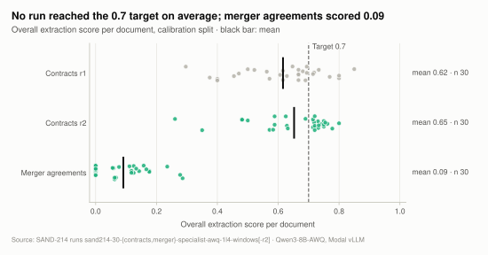
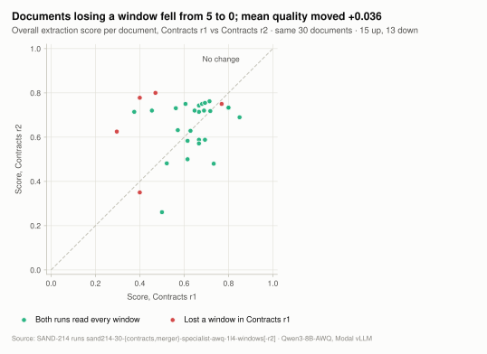
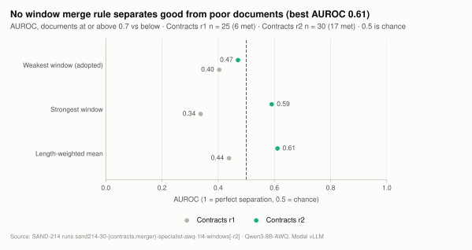
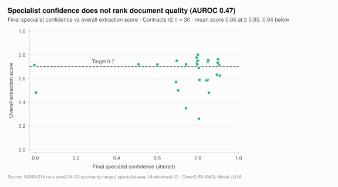
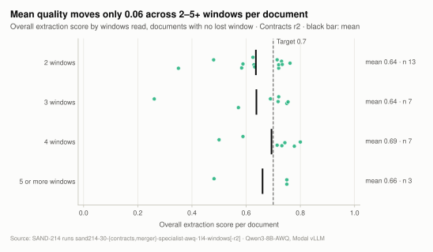

# #214 window merge rules — results, 2026-11-21

Three specialist runs on the runbook-v2 **calibration split** (n=30 each), Qwen3-8B-AWQ on
one Modal L4 at client concurrency 16, dataset revision `ff4ca546` with the interim and
near-gold overlays. Operator initials on every start: JJB. The app was torn down after the
last run, leaving zero containers warm.

| Run | Spec hash | Mean overall | Lost windows | Windows | GPU USD (est.) | Dated report |
| --- | --- | --- | --- | --- | --- | --- |
| contracts r1 | `38603971` | 0.616 | 5 docs | 95 | 0.331 | `contracts/RUN-30-CONTRACTS-AWQ-1L4-C16-REPORT.md` |
| contracts r2 (length fix) | `c75f8e4e` | 0.652 | 0 | 95 | 0.621 | `contracts/RUN-30-CONTRACTS-AWQ-1L4-C16-R2-REPORT.md` |
| merger (`maud_v2`) | `3bad2758` | 0.091 | 0 | 230 | 0.840 | `merger_agreement/RUN-30-MERGER-AWQ-1L4-C16-REPORT.md` |

The GPU figures are the run records' `estimated_gpu_cost_usd`, which bills wall time, idle
time included. r2 started while the merger leg held the fleet, so its 2,794 s wall includes
1,930 s of idle container time. Serving records are in `*.serving.json` here and in
`reports/serving/SAND-214/1L4/n=30/`. Routing audits (`sandbox run routing --run-id <id>
--json`) are in `routing/`.

## Findings

- **The length fix works.** r1 dropped six windows across five documents (one document
  dropped two): a decode ran to the 8,192-token cap and the window was dropped. r2 adds
  Qwen3 anti-repetition sampling (top_p 0.8, top_k 20, presence_penalty 1.0) and one length
  re-sample. It dropped none. On the same documents r2 gains +0.036 mean (15 wins, 13 losses).
  The r1 documents that had dropped a window gained the most (0.296→0.625, 0.400→0.778,
  0.471→0.800).
- **No merge rule separates quality yet.** On r2, `window_rules` (n=30, 17 met the 0.7
  target) gives AUROC 0.47 for min, 0.59 for max and 0.61 for length-weighted. On r1 the
  sample is n=25: the five documents with a dropped window are excluded by document (the
  routing audit's `partial_excluded`), matching the six dropped windows. The AUROCs there
  are 0.40, 0.34 and 0.44. The adopted rule stays the weakest window. n=30 is too small to
  switch on.
- **Specialist self-confidence does not predict quality.** Documents at final confidence
  ≥ 0.85 scored 0.584 (r1) and 0.665 (r2), against 0.644 below 0.85. r2 also stated `0.0`
  confidence on two documents that scored 0.714 and 0.482. A judge band cannot be
  set from the specialist's number alone.
- **Merger quality is a prompt or extraction problem, not a merge problem.** No agreement met
  0.7 (mean 0.091), so neither the window rules nor the bands are measurable on merger here.
- **Window count barely moves contracts quality.** Mean score by window count on r2: 2
  windows 0.636 (13 docs), 3 windows 0.638 (7), 4 windows 0.694 (7).

## Figures

Built with `python -m mailroom_sandbox.window_figures` (house style, linted); every number is in
`figures/sand214-windows.figure-data.csv`.

## Next experiments (configs committed, not started)

Interpretation and the pipeline application of these results are recorded in
[docs/sand214-window-learnings.md](../../../docs/sand214-window-learnings.md).

1. **Window length on Modal**, suite `sand214-window-length`: r2's posture and documents with
   `chunk_chars` 28,000 and 16,000 at r2's overlap share. r2 is the 43,000 arm. That gives
   95, 139 and 235 windows reading about 3.75M characters in each arm. Compare paired scores,
   failed windows, window_rules AUROC and GPU-seconds per document. Each arm is capped at
   $1.00 and one hour.
2. **Confidence cutoffs on the full pipeline**,
   `sand214-pipeline-150-calibration-judge-all`: the production slice-0100 configuration on
   150 calibration-split documents (30 per class) with `judge_band_high` 1.01, so the judge
   verifies every first pass at or above `low`. `sandbox run routing` then suggests a
   per-class band and reports above-band accuracy, retry yield and fire rates. The API cap
   is $6, an upper bound from list prices.
