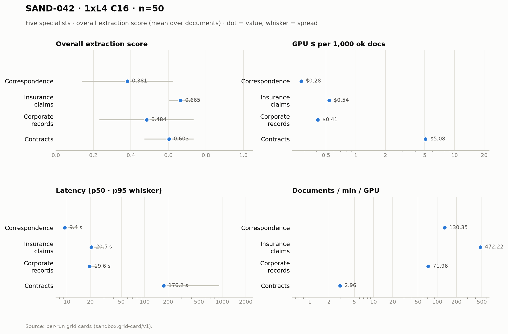

# SAND-042 · 1× L4 · client concurrency 16 · n=50 × 5 specialists

**Cells reported:** 5 of 5 · **Runbook:** `sand42-1l4-c16` · **Model:** Qwen/Qwen3-8B-AWQ · L4 @ $0.80/GPU-hr

## Shared conditions

| Condition | Value |
| --- | --- |
| Engine | — · max_model_len 32768 · max_num_seqs 16/replica · max_inputs 32 |
| Fleet | 1 replica(s) · client concurrency 16 (16 per replica) |
| Dataset | `Lucius-Morningstar/mailroom-dataset` ground_truth @ ed7576b6, split=all, seed 42, one class bucket, 50 per class stratified over every subclass (min 1 per sub-type) |
| Prompt | v1 `*_simplified` stems only |
| Output cap | max_tokens 8,192 · temperature 0.7 contracts + merger, 0.1 elsewhere |
| GPU telemetry | in-container nvidia-smi series, label `sand42-1l4-c16` |

## Per specialist

| Metric | Correspondence | Insurance Claims | Corporate Records | Contracts | Merger Agreements |
| --- | ---: | ---: | ---: | ---: | ---: |
| Quality (95% CI) | 0.381 [0.313, 0.447] | 0.665 [0.647, 0.683] | 0.484 [0.413, 0.553] | 0.603 [0.565, 0.642] | 0.029 [0.019, 0.039] |
| Scored documents | 50 | 50 | 50 | 45 | 50 |
| Scoring method | suite | suite | suite | suite+cuad | suite+maud |
| Ok rate (Wilson) | 50/50 100.0% [0.929, 1.000] | 50/50 100.0% [0.929, 1.000] | 50/50 100.0% [0.929, 1.000] | 50/50 100.0% [0.929, 1.000] | 50/50 100.0% [0.929, 1.000] |
| Schema-valid rate | 100.0% | 28.0% | 96.0% | 100.0% | 100.0% |
| Length-capped | 0 | 0 | 0 | 0 | 0 |
| p50 latency (s) | 9.4 | 20.5 | 19.6 | 176.2 | 1,045.6 |
| p95 latency (s) | 14.0 | 30.3 | 24.3 | 914.4 | 1,891.2 |
| SLO (s) · met | 60 · yes | 60 · yes | 60 · yes | 300 · no | 1,800 · no |
| Documents/min/GPU | 130.35 | 472.22 | 71.96 | 2.96 | 0.73 |
| Goodput docs/min/GPU | 130.35 | 472.22 | 71.96 | 0.00 | 0.00 |
| Tokens/s/GPU | 5,966.5 | 29,287.6 | 4,924.8 | 920.8 | 1,262.0 |
| Wall (s) | 23.0 | 6.4 | 41.7 | 1,012.0 | 4,098.5 |
| Billed GPU $ (run) | $0.0140 | $0.0268 | $0.0206 | $0.2541 | $0.9110 |
| $ / 1k ok docs | $0.279800 | $0.536440 | $0.412340 | $5.082960 | $18.219480 |
| $ / 1k schema-valid | $0.279800 | $1.915857 | $0.429521 | $5.082960 | $18.219480 |
| GPU util (mean/p95/peak) | 44.4% mean / 100.0 p95 / 100.0% peak (n=11) | 74.6% mean / 100.0 p95 / 100.0% peak (n=21) | 67.8% mean / 100.0 p95 / 100.0% peak (n=16) | 94.5% mean / 100.0 p95 / 100.0% peak (n=167) | 98.2% mean / 100.0 p95 / 100.0% peak (n=651) |
| GPU mem used (mean) | 21,002 MiB (91.2% of 23,034) | 21,025 MiB (91.3% of 23,034) | 21,026 MiB (91.3% of 23,034) | 21,024 MiB (91.3% of 23,034) | 21,027 MiB (91.3% of 23,034) |
| GPU mem bandwidth (mean) | 38.9% mean | 66.9% mean | 47.2% mean | 84.7% mean | 78.2% mean |
| Sampling coverage | 100.0% | 100.0% | 100.0% | 88.4% ⚠ below the 90% gate (issue #128) | 100.0% |
| GPU power (W, mean) | 51.0 | 61.7 | 59.2 | 70.5 | 71.7 |
| GPU temp (C, mean) | 73.6 | 75.2 | 75.1 | 75.8 | 76.5 |
| KV cache use (max %) | 0.0 | 0.0 | 0.0 | 0.0 | 0.0 |
| Preemptions | 0 | 0 | 0 | 0 | 0 |
| Length finishes | 0 | 0 | 0 | 0 | 10 |

## Figure

## Cost (computed from the session)

The fleet is pinned warm (`min_containers=1`) from deploy to teardown, so Modal meters the **whole window** — the cold boot and the idle between specialists included. This is computed from the session's own timestamps, not scraped from the billing CLI (whose figures are credits-based and workspace-wide).

| Fleet cost | Value |
| --- | ---: |
| Replicas × GPU | 1 × L4 @ $0.80/GPU-hr |
| Cold boot (deploy → ready) | not captured |
| Fleet window (deploy → teardown) | 5,690.0 s |
| Fleet GPU-hours | 1.5806 |
| **Fleet GPU $** | **$1.2644** |
| Of which the five runs | 5,519.5 s (97.0%) |
| Boot + idle overhead | 170.5 s |

## Per-run cards

| Specialist | Run ID | Card |
| --- | --- | --- |
| Correspondence | `sand42-50-correspondence-specialist-awq-1l4-c16` | [sand42-50-correspondence-specialist-awq-1l4-c16.card.md](correspondence/sand42-50-correspondence-specialist-awq-1l4-c16.card.md) |
| Insurance Claims | `sand42-50-insurance-claims-specialist-awq-1l4-c16` | [sand42-50-insurance-claims-specialist-awq-1l4-c16.card.md](insurance_claims/sand42-50-insurance-claims-specialist-awq-1l4-c16.card.md) |
| Corporate Records | `sand42-50-corporate-records-specialist-awq-1l4-c16` | [sand42-50-corporate-records-specialist-awq-1l4-c16.card.md](corporate_records/sand42-50-corporate-records-specialist-awq-1l4-c16.card.md) |
| Contracts | `sand42-50-contracts-specialist-awq-1l4-c16` | [sand42-50-contracts-specialist-awq-1l4-c16.card.md](contracts/sand42-50-contracts-specialist-awq-1l4-c16.card.md) |
| Merger Agreements | `sand42-50-merger-specialist-awq-1l4-c16` | [sand42-50-merger-specialist-awq-1l4-c16.card.md](merger_agreement/sand42-50-merger-specialist-awq-1l4-c16.card.md) |

_Merger dominates pooled throughput (≈ 112k prompt tokens per agreement on the frozen settings), so no pooled column is reported here — compare per class._

_Generated 2026-10-12T06:23:58+00:00 by `sandbox run card --runbook sand42-1l4-c16` from the committed per-run `*.card.json`._
