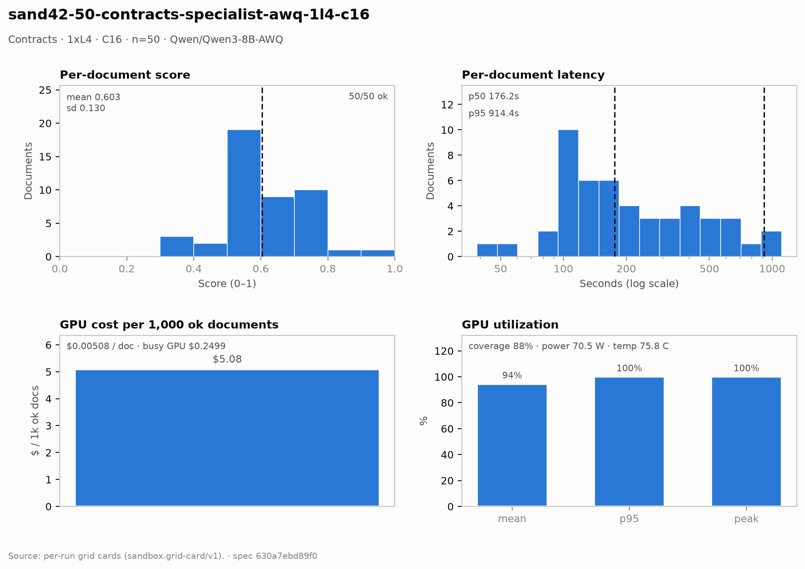

# Contracts — 1× L4 · C16 · n=50

**Run:** `sand42-50-contracts-specialist-awq-1l4-c16` · **Model:** Qwen/Qwen3-8B-AWQ · vLLM v0.29.0 · Modal `sandbox-vllm` · L4 @ $0.80/GPU-hr

## Conditions

| Condition | Value |
| --- | --- |
| Task | contracts_specialist |
| Prompt | contracts_specialist_v33_simplified |
| Temperature | 0.7 (posture knob) |
| Output cap (max_tokens) | 8,192 |
| Input cap (max_input_chars) | 49,000 |
| Chunk window (chars) | 43000 |
| Chunk overlap (chars) | 6000 |
| Job retries | 2 |
| Dataset | Lucius-Morningstar/mailroom-dataset ground_truth @ ed7576b6, split=all, seed 42 |
| Draw | 50 docs (fingerprint 83eb6b1f2c7e) |
| Engine | awq_marlin · fp8 KV · CUDA graphs [1, 2, 4, 8, 16] · prefix caching on · thinking off |
| Admission | max_model_len 32768 · max_num_seqs 16 per replica · max_inputs 32 |

## Score & cost card

| Metric | Value |
| --- | ---: |
| **Run** |  |
| Run ID | `sand42-50-contracts-specialist-awq-1l4-c16` |
| GPUs / replicas | 1 |
| Concurrency | 16 (16 per replica) |
| Documents | 50 |
| Spec hash | 630a7ebd… |
| **Time** |  |
| Wall (busy) | 1,124.43 s |
| GPU seconds | 1,143.67 s |
| Cold boot | 0.27 s |
| **Cost** |  |
| Busy-window GPU $ | $0.249873 |
| Billed GPU $ | $0.254148 |
| Billed seconds | 1,143.67 s |
| Idle $ | $0.046888 (211.00 s) |
| Cost per document | $0.005083 |
| Cost per ok document | $0.005083 |
| Cost per 1M tokens | $0.2727 |
| **Tokens** |  |
| Prompt tokens | 799,423 |
| Completion tokens | 132,402 (14.2%) |
| Total tokens | 931,825 |
| Tokens per document | 18,636 |
| Per document: instructions + template | 4,313 (23.1%) |
| Per document: document text | 11,676 (62.6%) |
| Per document: output | 2,648 (14.2%) |
| Instruction tokens per model call | 2,537 over 85 calls |
| Token split basis | document chars ÷ 4.5 chars/token; instructions are the remainder |
| Completion p95 / max (ok docs) | 6,822 / 11,638 |
| **Throughput** |  |
| Tokens / second | 828.7 |
| Tokens / second per L4 | 828.7 |
| Documents / minute | 2.67 |
| **Latency (per document, ok rows)** |  |
| Mean | 292.30 s |
| p50 | 176.20 s |
| p95 | 914.39 s |
| Max | 1,109.38 s |
| **Engine (vLLM /metrics)** |  |
| Parallelism (Σ latency ÷ wall) | 13.00× of 16 |
| Slot occupancy | 81.2% |
| Coverage | replicas observed: 1 of 1 |
| Requests per replica (this run) | 24 |
| Mean TTFT per replica | 14.352 s |
| Prefix-cache hit per replica | 28.1% |
| Preemptions per replica (this run) | 0 |
| Length-capped finishes per replica (this run) | 0 |
| **GPU hardware (nvidia-smi)** | 167 samples · serving-replica nvidia-smi |
| GPU utilization | 94.5 % mean (p95 100.0 / peak 100.0 / min 0.0) |
| Sampling coverage | 88.4 % — **below the 90% gate (issue #128)** |
| GPU power draw | 70.5 W (min 29.7 / max 74.0) of 72 W cap |
| GPU memory bandwidth | 84.7 % (min 0.0 / max 100.0) |
| GPU SM clock | 1,305 MHz (min 975 / max 2,040) |
| GPU temperature | 75.8 C (min 53.0 / max 81.0) |
| GPU memory used | 21,024 MiB (min 20,792 / max 21,026) |
| **Quality** |  |
| Overall extraction score | 0.6033 (sd 0.130) |
| Score min / max | 0.3030 / 0.9333 |
| Scoring method | `suite+cuad` |
| Schema-valid rate | 1.00 |
| Parse errors | 0 |
| Errors | 0 / 50 |
| **Clause scoring (CUAD)** |  |
| Docs with CUAD labels | 45 |
| Micro precision / recall / F1 | 0.610 / 0.616 / 0.613 |
| Metadata value checks | 72 / 127 |
| Suite field score (mean) | not captured |

## Figure

## Per-document results

| # | Document | OK | Score | Latency (s) | Prompt tok | Completion tok | Error |
| ---: | --- | --- | ---: | ---: | ---: | ---: | --- |
| 1 | `DOC-f5a54932794ef16e` | yes | 0.6667 | 97.3 | 5302 | 1021 | — |
| 2 | `DOC-6b4cc54c8c4d796f` | yes | — | 103.5 | 4015 | 1075 | — |
| 3 | `DOC-b1aba7df0380a1b2` | yes | — | 109.3 | 5032 | 1100 | — |
| 4 | `DOC-a9850db362f57916` | yes | — | 115.1 | 6764 | 1128 | — |
| 5 | `DOC-fc9671ccde642e8d` | yes | — | 127.1 | 7936 | 1242 | — |
| 6 | `DOC-3c07c9ccd9a01d6e` | yes | 0.5833 | 142.2 | 7428 | 1369 | — |
| 7 | `DOC-385a86c69f8e562c` | yes | 0.6667 | 153.6 | 6560 | 1536 | — |
| 8 | `DOC-e235bc9735f96335` | yes | 0.5000 | 162.0 | 10699 | 1592 | — |
| 9 | `DOC-03529267ee75444d` | yes | 0.7273 | 178.3 | 10583 | 1825 | — |
| 10 | `DOC-6671a684f52f82a9` | yes | 0.5714 | 185.0 | 11320 | 1823 | — |
| 11 | `DOC-0812d9d3e2b1baa0` | yes | 0.5385 | 208.9 | 18679 | 2165 | — |
| 12 | `DOC-593f2c6de770b84c` | yes | 0.7407 | 219.0 | 9228 | 2298 | — |
| 13 | `DOC-f8b0d4bcbac60ca2` | yes | 0.6154 | 109.2 | 3824 | 1260 | — |
| 14 | `DOC-e4272758b561f8cd` | yes | 0.5556 | 137.2 | 6987 | 1485 | — |
| 15 | `DOC-81c4ce12d907380c` | yes | 0.7500 | 122.3 | 7047 | 1365 | — |
| 16 | `DOC-9a36838df2878b37` | yes | 0.5385 | 108.8 | 8142 | 1201 | — |
| 17 | `DOC-b83763aeff114369` | yes | 0.5294 | 123.1 | 7446 | 1330 | — |
| 18 | `DOC-812192e392d8d410` | yes | 0.6000 | 164.4 | 5551 | 1866 | — |
| 19 | `DOC-e998c563b82122b9` | yes | 0.5556 | 115.0 | 10006 | 1270 | — |
| 20 | `DOC-035731e655e67aab` | yes | 0.5556 | 141.1 | 5207 | 1488 | — |
| 21 | `DOC-70f90b46b2c4f1a6` | yes | 0.5714 | 38.5 | 3154 | 460 | — |
| 22 | `DOC-27b649fe2f6fae8e` | yes | 0.9333 | 114.7 | 5464 | 1327 | — |
| 23 | `DOC-4fb6419e37bff201` | yes | 0.6667 | 445.4 | 22234 | 4698 | — |
| 24 | `DOC-1e22a2d4068b8650` | yes | 0.7143 | 203.4 | 7587 | 2209 | — |
| 25 | `DOC-0752e0811f5f5eb7` | yes | 0.3030 | 485.8 | 41619 | 5199 | — |
| 26 | `DOC-1ddc9333769d27e4` | yes | 0.5000 | 116.3 | 4450 | 1367 | — |
| 27 | `DOC-8993ad1085e08bd0` | yes | 0.5946 | 246.7 | 22402 | 2849 | — |
| 28 | `DOC-c9d4c4f8ff433527` | yes | 0.5000 | 59.4 | 7730 | 729 | — |
| 29 | `DOC-186145066ab191fa` | yes | 0.4000 | 86.8 | 3718 | 1022 | — |
| 30 | `DOC-472f423cdf0819ef` | yes | 0.5714 | 107.2 | 4656 | 1304 | — |
| 31 | `DOC-dfb4e69a3ab10dc9` | yes | 0.5263 | 174.1 | 7378 | 1917 | — |
| 32 | `DOC-fe06800cc62e5e19` | yes | 0.6667 | 154.7 | 8619 | 1761 | — |
| 33 | `DOC-62b300182901e850` | yes | 0.3636 | 277.6 | 33346 | 3009 | — |
| 34 | `DOC-9cee2e10b449a71c` | yes | 0.7647 | 458.2 | 21752 | 5023 | — |
| 35 | `DOC-73055dbb1e9f5f2f` | yes | 0.7143 | 509.3 | 49409 | 5489 | — |
| 36 | `DOC-f45b328fd8a54c8b` | yes | 0.8421 | 86.8 | 4608 | 892 | — |
| 37 | `DOC-1266801f2faad19f` | yes | 0.6977 | 660.0 | 33383 | 4965 | — |
| 38 | `DOC-01849fa3020a5ac1` | yes | 0.5000 | 265.0 | 4173 | 1025 | — |
| 39 | `DOC-4b57f485708ab60b` | yes | 0.6000 | 309.7 | 6639 | 1125 | — |
| 40 | `DOC-712c3f92a0a56b77` | yes | 0.5000 | 680.8 | 56227 | 5163 | — |
| 41 | `DOC-2b510409d3b9a4a6` | yes | 0.7619 | 809.6 | 21668 | 6822 | — |
| 42 | `DOC-dbe52fd78e44b0ef` | yes | 0.7692 | 308.0 | 18750 | 1585 | — |
| 43 | `DOC-b87880882e5fe354` | yes | — | 914.4 | 19278 | 5579 | — |
| 44 | `DOC-dfd20f94bb76b6e4` | yes | 0.5455 | 346.6 | 21000 | 2357 | — |
| 45 | `DOC-e218d39bb2f3c5ef` | yes | 0.5000 | 401.8 | 19923 | 3047 | — |
| 46 | `DOC-e0d31c39359cb803` | yes | 0.3784 | 432.1 | 6879 | 3150 | — |
| 47 | `DOC-be1eccde5bae9c82` | yes | 0.4286 | 410.4 | 9330 | 3349 | — |
| 48 | `DOC-8f737e9fec8f24f0` | yes | 0.7407 | 606.2 | 35815 | 5348 | — |
| 49 | `DOC-53e364f030a30b5c` | yes | 0.7742 | 973.7 | 94991 | 11638 | — |
| 50 | `DOC-e29140d2e8e989be` | yes | 0.6250 | 1,109.4 | 45485 | 8555 | — |

_Generated 2026-10-12T08:00:23+00:00 by `sandbox run card`. Machine-readable twin: `sand42-50-contracts-specialist-awq-1l4-c16.card.json`._
