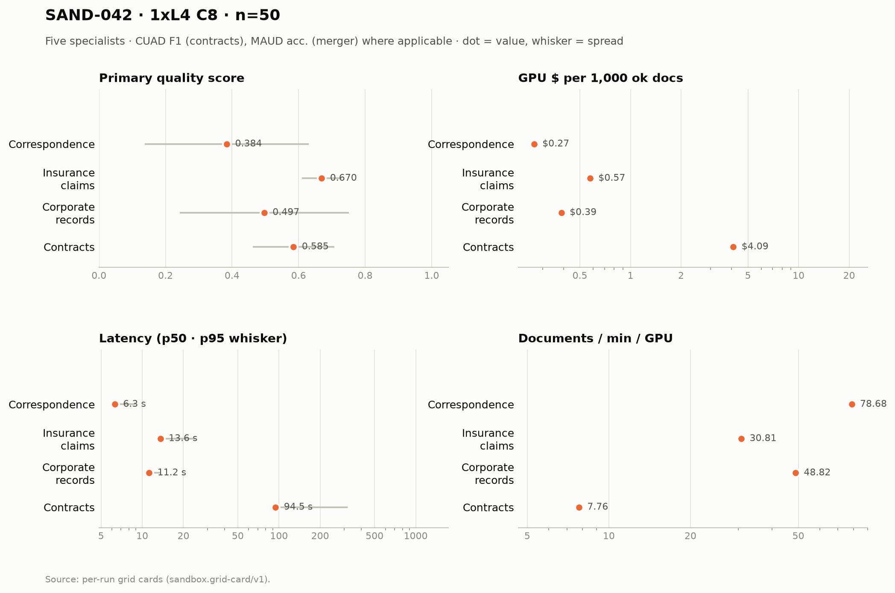

# SAND-042 · 1× L4 · client concurrency 8 · n=50 × 5 specialists

**Cells reported:** 5 of 5 · **Runbook:** `sand42-1l4-c8` · **Model:** Qwen/Qwen3-8B-AWQ · L4 @ $0.80/GPU-hr

## Shared conditions

| Condition | Value |
| --- | --- |
| Engine | — · max_model_len 32768 · max_num_seqs 16/replica · max_inputs 32 |
| Fleet | 1 replica(s) · client concurrency 8 (8 per replica) |
| Dataset | `Lucius-Morningstar/mailroom-dataset` ground_truth @ ed7576b6, split=all, seed 42, one class bucket, 50 per class stratified over every subclass (min 1 per sub-type) |
| Prompt | v1 `*_simplified` stems only |
| Output cap | max_tokens 8,192 · temperature 0.7 contracts + merger, 0.1 elsewhere |
| GPU telemetry | in-container nvidia-smi series, label `sand42-1l4-c8` |

## Per specialist

| Metric | Correspondence | Insurance Claims | Corporate Records | Contracts | Merger Agreements |
| --- | ---: | ---: | ---: | ---: | ---: |
| Quality (95% CI) | 0.384 [0.316, 0.451] | 0.670 [0.653, 0.685] | 0.497 [0.427, 0.569] | 0.579 [0.543, 0.614] | 0.021 [0.012, 0.030] |
| Scored documents | 50 | 50 | 50 | 45 | 50 |
| Scoring method | suite | suite | suite | suite+cuad | suite+maud |
| Ok rate (Wilson) | 50/50 100.0% [0.929, 1.000] | 50/50 100.0% [0.929, 1.000] | 50/50 100.0% [0.929, 1.000] | 50/50 100.0% [0.929, 1.000] | 50/50 100.0% [0.929, 1.000] |
| Schema-valid rate | 100.0% | 30.0% | 96.0% | 100.0% | 100.0% |
| Length-capped | 0 | 0 | 0 | 0 | 0 |
| p50 latency (s) | 6.3 | 13.6 | 11.2 | 94.5 | 574.9 |
| p95 latency (s) | 8.9 | 24.6 | 13.6 | 316.4 | 1,324.9 |
| SLO (s) · met | 60 · yes | 60 · yes | 60 · yes | 300 · no | 1,800 · yes |
| Documents/min/GPU | 78.68 | 30.81 | 48.82 | 7.76 | 5.30 |
| Goodput docs/min/GPU | 78.68 | 30.81 | 48.82 | 0.00 | 5.30 |
| Tokens/s/GPU | 3,596.5 | 1,916.3 | 3,342.2 | 2,401.8 | 9,154.7 |
| Wall (s) | 38.1 | 97.4 | 61.4 | 386.8 | 566.3 |
| Billed GPU $ (run) | $0.0133 | $0.0287 | $0.0194 | $0.2046 | $1.0356 |
| $ / 1k ok docs | $0.266880 | $0.574880 | $0.387920 | $4.091500 | $20.712260 |
| $ / 1k schema-valid | $0.266880 | $1.916267 | $0.404083 | $4.091500 | $20.712260 |
| GPU util (mean/p95/peak) | 73.8% mean / 99.0 p95 / 99.0% peak (n=8) | 92.8% mean / 99.0 p95 / 99.0% peak (n=18) | 77.6% mean / 100.0 p95 / 100.0% peak (n=14) | 97.6% mean / 100.0 p95 / 100.0% peak (n=139) | 98.3% mean / 100.0 p95 / 100.0% peak (n=699) |
| GPU mem used (mean) | 20,994 MiB (91.1% of 23,034) | 21,023 MiB (91.3% of 23,034) | 21,023 MiB (91.3% of 23,034) | 21,026 MiB (91.3% of 23,034) | 21,027 MiB (91.3% of 23,034) |
| GPU mem bandwidth (mean) | not captured | not captured | not captured | not captured | not captured |
| Sampling coverage | 96.6% | 94.8% | 100.0% | 100.0% | 100.0% |
| GPU power (W, mean) | 63.3 | 69.4 | 63.4 | 71.4 | 71.7 |
| GPU temp (C, mean) | 51.6 | 60.3 | 64.4 | 73.0 | 75.6 |
| KV cache use (max %) | 0.0 | 0.0 | 0.0 | 0.0 | 0.0 |
| Preemptions | 0 | 0 | 0 | 0 | 0 |
| Length finishes | 0 | 0 | 0 | 0 | 9 |

## Figure

## Cost (computed from the session)

The fleet is pinned warm (`min_containers=1`) from deploy to teardown, so Modal meters the **whole window** — the cold boot and the idle between specialists included. This is computed from the session's own timestamps, not scraped from the billing CLI (whose figures are credits-based and workspace-wide).

| Fleet cost | Value |
| --- | ---: |
| Replicas × GPU | 1 × L4 @ $0.80/GPU-hr |
| Cold boot (deploy → ready) | not captured |
| Fleet window (deploy → teardown) | 6,080.3 s |
| Fleet GPU-hours | 1.6890 |
| **Fleet GPU $** | **$1.3512** |
| Of which the five runs | 5,857.5 s (96.3%) |
| Boot + idle overhead | 222.8 s |

## Per-run cards

| Specialist | Run ID | Card |
| --- | --- | --- |
| Correspondence | `sand42-50-correspondence-specialist-awq-1l4-c8` | [sand42-50-correspondence-specialist-awq-1l4-c8.card.md](correspondence/sand42-50-correspondence-specialist-awq-1l4-c8.card.md) |
| Insurance Claims | `sand42-50-insurance-claims-specialist-awq-1l4-c8` | [sand42-50-insurance-claims-specialist-awq-1l4-c8.card.md](insurance_claims/sand42-50-insurance-claims-specialist-awq-1l4-c8.card.md) |
| Corporate Records | `sand42-50-corporate-records-specialist-awq-1l4-c8` | [sand42-50-corporate-records-specialist-awq-1l4-c8.card.md](corporate_records/sand42-50-corporate-records-specialist-awq-1l4-c8.card.md) |
| Contracts | `sand42-50-contracts-specialist-awq-1l4-c8` | [sand42-50-contracts-specialist-awq-1l4-c8.card.md](contracts/sand42-50-contracts-specialist-awq-1l4-c8.card.md) |
| Merger Agreements | `sand42-50-merger-specialist-awq-1l4-c8` | [sand42-50-merger-specialist-awq-1l4-c8.card.md](merger_agreement/sand42-50-merger-specialist-awq-1l4-c8.card.md) |

_Merger dominates pooled throughput (≈ 112k prompt tokens per agreement on the frozen settings), so no pooled column is reported here — compare per class._

_Generated 2026-10-12T05:21:28+00:00 by `sandbox run card --runbook sand42-1l4-c8` from the committed per-run `*.card.json`._
