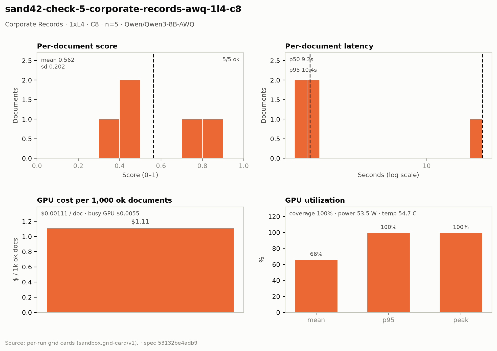

# Corporate Records — 1× L4 · C8 · n=5

**Run:** `sand42-check-5-corporate-records-awq-1l4-c8` · **Model:** Qwen/Qwen3-8B-AWQ · vLLM v0.29.0 · Modal `sandbox-vllm` · L4 @ $0.80/GPU-hr

## Conditions

| Condition | Value |
| --- | --- |
| Task | corporate_records_specialist |
| Prompt | corporate_records_specialist_simplified |
| Temperature | 0.1 (vendored call site) |
| Output cap (max_tokens) | 8,192 |
| Input cap (max_input_chars) | 15,000 |
| Job retries | 2 |
| Dataset | Lucius-Morningstar/mailroom-dataset ground_truth @ ed7576b6, split=all, seed 42 |
| Draw | 5 docs (fingerprint 34c1303db918) |
| Engine | awq_marlin · fp8 KV · CUDA graphs [1, 2, 4, 8, 16] · prefix caching on · thinking off |
| Admission | max_model_len 32768 · max_num_seqs 16 per replica · max_inputs 32 |

## Score & cost card

| Metric | Value |
| --- | ---: |
| **Run** |  |
| Run ID | `sand42-check-5-corporate-records-awq-1l4-c8` |
| GPUs / replicas | 1 |
| Concurrency | 8 (8 per replica) |
| Documents | 5 |
| Spec hash | 53132be4… |
| **Time** |  |
| Wall (busy) | 24.94 s |
| GPU seconds | 25.03 s |
| Cold boot | 0.24 s |
| **Cost** |  |
| Busy-window GPU $ | $0.005543 |
| Billed GPU $ | $0.005563 |
| Billed seconds | 25.03 s |
| Idle $ | $0.004240 (19.08 s) |
| Cost per document | $0.001113 |
| Cost per ok document | $0.001113 |
| Cost per 1M tokens | $0.2663 |
| **Tokens** |  |
| Prompt tokens | 20,069 |
| Completion tokens | 822 (3.9%) |
| Total tokens | 20,891 |
| Tokens per document | 4,178 |
| Per document: instructions + template | 2,214 (53.0%) |
| Per document: document text | 1,799 (43.1%) |
| Per document: output | 164 (3.9%) |
| Instruction tokens per model call | 2,214 over 5 calls |
| Token split basis | document chars ÷ 4.5 chars/token; instructions are the remainder |
| Completion p95 / max (ok docs) | 210 / 210 |
| **Throughput** |  |
| Tokens / second | 837.5 |
| Tokens / second per L4 | 837.5 |
| Documents / minute | 12.03 |
| **Latency (per document, ok rows)** |  |
| Mean | 9.38 s |
| p50 | 9.16 s |
| p95 | 10.43 s |
| Max | 10.43 s |
| **Engine (vLLM /metrics)** |  |
| Parallelism (Σ latency ÷ wall) | 1.88× of 8 |
| Slot occupancy | 23.5% |
| Coverage | replicas observed: 1 of 1 |
| Requests per replica (this run) | 5 |
| Mean TTFT per replica | 2.059 s |
| Prefix-cache hit per replica | 31.8% |
| Preemptions per replica (this run) | 0 |
| Length-capped finishes per replica (this run) | 0 |
| **GPU hardware (nvidia-smi)** | 3 samples · serving-replica nvidia-smi |
| GPU utilization | 66.3 % mean (p95 100.0 / peak 100.0 / min 0.0) |
| Sampling coverage | 100.0 % |
| GPU power draw | 53.5 W (min 29.4 / max 72.7) of 72 W cap |
| GPU memory bandwidth | 51.7 % (min 0.0 / max 100.0) |
| GPU SM clock | 1,605 MHz (min 1,170 / max 2,040) |
| GPU temperature | 54.7 C (min 53.0 / max 56.0) |
| GPU memory used | 21,024 MiB (min 21,024 / max 21,024) |
| **Quality** |  |
| Overall extraction score | 0.5625 (sd 0.202) |
| Score min / max | 0.3590 / 0.8205 |
| Scoring method | `suite` |
| Schema-valid rate | 1.00 |
| Parse errors | 0 |
| Errors | 0 / 5 |

## Figure

## Per-document results

| # | Document | OK | Score | Latency (s) | Prompt tok | Completion tok | Error |
| ---: | --- | --- | ---: | ---: | ---: | ---: | --- |
| 1 | `DOC-f134b9491efc5c57` | yes | 0.7949 | 9.1 | 2865 | 141 | — |
| 2 | `DOC-e478fa89043a29e3` | yes | 0.8205 | 9.1 | 2910 | 151 | — |
| 3 | `DOC-37152a33cfb70d37` | yes | 0.4103 | 9.2 | 2902 | 161 | — |
| 4 | `DOC-0a8eb16fff7e67ca` | yes | 0.3590 | 9.2 | 5246 | 159 | — |
| 5 | `DOC-a973ebf005e0e785` | yes | 0.4278 | 10.4 | 6146 | 210 | — |

_Generated 2026-10-12T17:47:45+00:00 by `sandbox run card`. Machine-readable twin: `sand42-check-5-corporate-records-awq-1l4-c8.card.json`._
