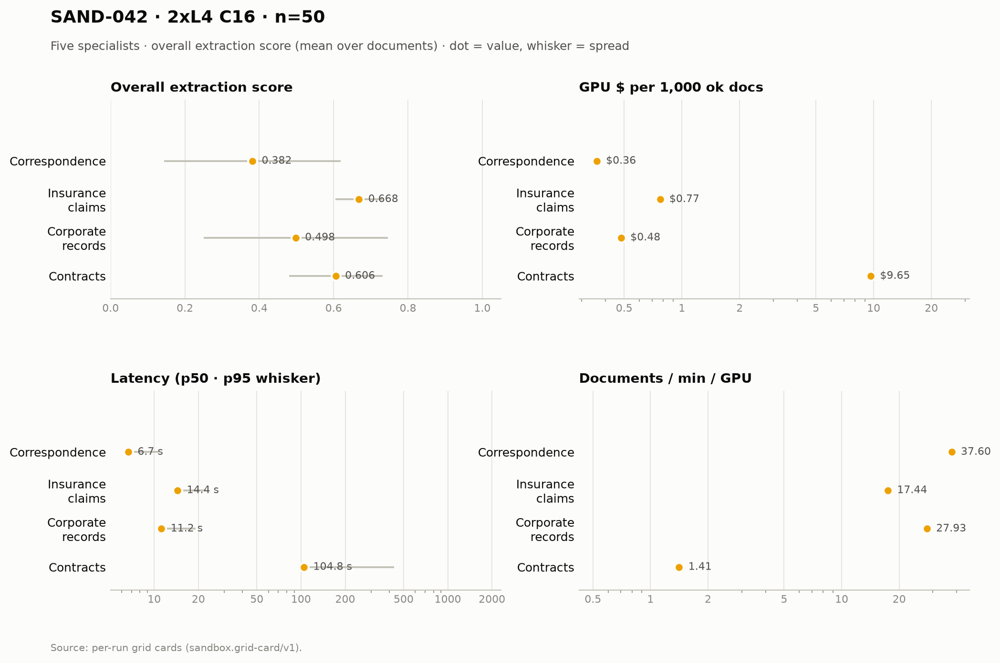

# SAND-042 · 2× L4 · client concurrency 16 (8 per replica) · n=50 × 5 specialists

**Cells reported:** 5 of 5 · **Runbook:** `sand42-2l4-c16` · **Model:** Qwen/Qwen3-8B-AWQ · L4 @ $0.80/GPU-hr

## Shared conditions

| Condition | Value |
| --- | --- |
| Engine | — · max_model_len 32768 · max_num_seqs 16/replica · max_inputs 32 |
| Fleet | 2 replica(s) · client concurrency 16 (8 per replica) |
| Dataset | `Lucius-Morningstar/mailroom-dataset` ground_truth @ ed7576b6, split=all, seed 42, one class bucket, 50 per class stratified over every subclass (min 1 per sub-type) |
| Prompt | v1 `*_simplified` stems only |
| Output cap | max_tokens 8,192 · temperature 0.7 contracts + merger, 0.1 elsewhere |
| GPU telemetry | in-container nvidia-smi series, label `sand42-2l4-c16` |

## Per specialist

| Metric | Correspondence | Insurance Claims | Corporate Records | Contracts | Merger Agreements |
| --- | ---: | ---: | ---: | ---: | ---: |
| Quality (95% CI) | 0.382 [0.318, 0.447] | 0.668 [0.650, 0.686] | 0.498 [0.430, 0.565] | 0.606 [0.569, 0.642] | 0.024 [0.015, 0.033] |
| Scored documents | 50 | 50 | 50 | 44 | 50 |
| Quality SD | 0.237 | 0.063 | 0.247 | 0.126 | 0.033 |
| Scoring method | suite | suite | suite | suite+cuad | suite+maud |
| Clause metric | — | — | — | CUAD F1 0.604 · 44 labeled | MAUD acc 2.3% · 349/811 answered |
| Ok rate (Wilson) | 50/50 100.0% [0.929, 1.000] | 50/50 100.0% [0.929, 1.000] | 50/50 100.0% [0.929, 1.000] | 49/50 98.0% [0.895, 0.996] | 50/50 100.0% [0.929, 1.000] |
| Schema-valid rate | 100.0% | 24.0% | 98.0% | 100.0% | 100.0% |
| Parse errors | 0 | 0 | 0 | 0 | 0 |
| Length-capped | 0 | 0 | 0 | 1 | 0 |
| Error kinds | — | — | — | LengthFinishReasonError×1 | — |
| p50 latency (s) | 6.7 | 14.4 | 11.2 | 104.8 | 605.1 |
| p95 latency (s) | 10.8 | 22.5 | 19.1 | 431.5 | 1,742.0 |
| SLO (s) · met | 60 · yes | 60 · yes | 60 · yes | 300 · no | 1,800 · yes |
| Documents/min | 75.20 | 34.89 | 55.86 | 2.82 | 1.05 |
| Documents/min/GPU | 37.60 | 17.44 | 27.93 | 1.41 | 0.52 |
| Goodput docs/min/GPU | 37.60 | 17.44 | 27.93 | 0.00 | 0.52 |
| Tokens/s/GPU | 1,719.0 | 1,078.8 | 1,914.0 | 422.3 | 901.3 |
| Mean TTFT (s) | 1.04 | 1.33 | 1.55 | 2.51 | 3.93 |
| Prefix-cache hit | 62.5% | 57.2% | 49.9% | 37.7% | 18.8% |
| Wall (s) | 39.9 | 86.0 | 53.7 | 1,063.4 | 2,866.6 |
| Billed GPU $ (run) | $0.0180 | $0.0385 | $0.0241 | $0.4730 | $1.2749 |
| $ / 1k ok docs | $0.359540 | $0.769340 | $0.481800 | $9.653776 | $25.497100 |
| $ / 1k schema-valid | $0.359540 | $3.205583 | $0.491633 | $9.460700 | $25.497100 |
| $ / doc | $0.000360 | $0.000769 | $0.000482 | $0.009461 | $0.025497 |
| $ / ok doc | $0.000360 | $0.000769 | $0.000482 | $0.009654 | $0.025497 |
| $ / 1M tokens | $0.131 | $0.207 | $0.117 | $0.527 | $0.247 |
| GPU util (mean/p95/min–max) | 63.7% mean / 98.0 p95 / 0.0–100.0% min–max (n=12) | 76.3% mean / 100.0 p95 / 0.0–100.0% min–max (n=27) | 65.4% mean / 100.0 p95 / 0.0–100.0% min–max (n=18) | 79.9% mean / 100.0 p95 / 0.0–100.0% min–max (n=359) | 82.2% mean / 100.0 p95 / 0.0–100.0% min–max (n=962) |
| GPU mem used (mean) | 19,973 MiB (86.7% of 23,034) | 19,993 MiB (86.8% of 23,034) | 19,994 MiB (86.8% of 23,034) | 19,994 MiB (86.8% of 23,034) | 19,996 MiB (86.8% of 23,034) |
| GPU mem bandwidth (mean) | 57.8% mean | 69.0% mean | 52.3% mean | 76.8% mean | 69.0% mean |
| Sampling coverage | 95.6% | 100.0% | 65.6% ⚠ below the 90% gate (issue #128) | 99.4% | 99.6% |
| GPU power (W, mean) | 56.8 | 62.9 | 59.8 | 64.6 | 65.7 |
| GPU temp (C, mean) | 62.3 | 69.8 | 74.4 | 73.5 | 75.5 |
| KV cache use (max %) | 0.0 | 0.0 | 0.0 | 0.0 | 0.0 |
| Preemptions | 0 | 0 | 0 | 0 | 0 |
| Length finishes | 0 | 0 | 0 | 4 | 12 |

## Figure

## Cost (computed from the session)

The fleet is pinned warm (`min_containers=1`) from deploy to teardown, so Modal meters the **whole window** — the cold boot and the idle between specialists included. This is computed from the session's own timestamps, not scraped from the billing CLI (whose figures are credits-based and workspace-wide).

| Fleet cost | Value |
| --- | ---: |
| Replicas × GPU | 2 × L4 @ $0.80/GPU-hr |
| Cold boot (deploy → ready) | 292.0 s |
| Fleet window (deploy → teardown) | 4,507.0 s |
| Fleet GPU-hours | 2.5039 |
| **Fleet GPU $** | **$2.0031** |
| Of which the five runs | 4,114.0 s (91.3%) |
| Boot + idle overhead | 393.0 s |

## Per-run cards

| Specialist | Run ID | Card |
| --- | --- | --- |
| Correspondence | `sand42-50-correspondence-specialist-awq-2l4-c16` | [sand42-50-correspondence-specialist-awq-2l4-c16.card.md](correspondence/sand42-50-correspondence-specialist-awq-2l4-c16.card.md) |
| Insurance Claims | `sand42-50-insurance-claims-specialist-awq-2l4-c16` | [sand42-50-insurance-claims-specialist-awq-2l4-c16.card.md](insurance_claims/sand42-50-insurance-claims-specialist-awq-2l4-c16.card.md) |
| Corporate Records | `sand42-50-corporate-records-specialist-awq-2l4-c16` | [sand42-50-corporate-records-specialist-awq-2l4-c16.card.md](corporate_records/sand42-50-corporate-records-specialist-awq-2l4-c16.card.md) |
| Contracts | `sand42-50-contracts-specialist-awq-2l4-c16` | [sand42-50-contracts-specialist-awq-2l4-c16.card.md](contracts/sand42-50-contracts-specialist-awq-2l4-c16.card.md) |
| Merger Agreements | `sand42-50-merger-specialist-awq-2l4-c16` | [sand42-50-merger-specialist-awq-2l4-c16.card.md](merger_agreement/sand42-50-merger-specialist-awq-2l4-c16.card.md) |

_Merger dominates pooled throughput (≈ 112k prompt tokens per agreement on the frozen settings), so no pooled column is reported here — compare per class._

_Generated 2026-10-12T08:00:43+00:00 by `sandbox run card --runbook sand42-2l4-c16` from the committed per-run `*.card.json`._
