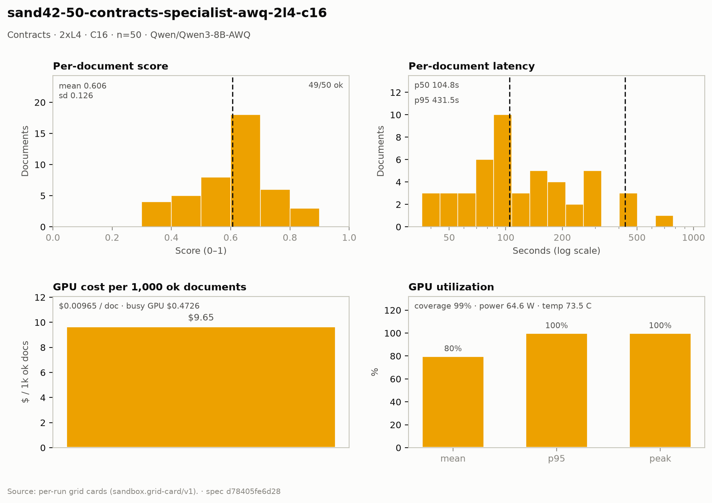

# Contracts — 2× L4 · C16 · n=50

**Run:** `sand42-50-contracts-specialist-awq-2l4-c16` · **Model:** Qwen/Qwen3-8B-AWQ · vLLM v0.29.0 · Modal `sandbox-vllm-b` · L4 @ $0.80/GPU-hr

## Conditions

| Condition | Value |
| --- | --- |
| Task | contracts_specialist |
| Prompt | contracts_specialist_v33_simplified |
| Temperature | 0.7 (posture knob) |
| Output cap (max_tokens) | 8,192 |
| Input cap (max_input_chars) | 49,000 |
| Chunk window (chars) | 43000 |
| Chunk overlap (chars) | 6000 |
| Job retries | 2 |
| Dataset | Lucius-Morningstar/mailroom-dataset ground_truth @ ed7576b6, split=all, seed 42 |
| Draw | 50 docs (fingerprint 83eb6b1f2c7e) |
| Engine | awq_marlin · fp8 KV · CUDA graphs [1, 2, 4, 8, 16] · prefix caching on · thinking off |
| Admission | max_model_len 32768 · max_num_seqs 16 per replica · max_inputs 32 |

## Score & cost card

| Metric | Value |
| --- | ---: |
| **Run** |  |
| Run ID | `sand42-50-contracts-specialist-awq-2l4-c16` |
| GPUs / replicas | 2 |
| Concurrency | 16 (8 per replica) |
| Documents | 50 |
| Spec hash | d78405fe… |
| **Time** |  |
| Wall (busy) | 1,063.39 s |
| GPU seconds | 1,064.33 s |
| Cold boot | 0.31 s |
| **Cost** |  |
| Busy-window GPU $ | $0.472616 |
| Billed GPU $ | $0.473035 |
| Billed seconds | 1,064.33 s |
| Idle $ | $0.242716 (546.11 s) |
| Cost per document | $0.009461 |
| Cost per ok document | $0.009654 |
| Cost per 1M tokens | $0.5267 |
| **Tokens** |  |
| Prompt tokens | 753,520 |
| Completion tokens | 144,543 (16.1%) |
| Total tokens | 898,063 |
| Tokens per document | 18,328 |
| Per document: instructions + template | 3,582 (19.5%) |
| Per document: document text | 11,795 (64.4%) |
| Per document: output | 2,950 (16.1%) |
| Instruction tokens per model call | 2,090 over 84 calls |
| Token split basis | document chars ÷ 4.5 chars/token; instructions are the remainder |
| Completion p95 / max (ok docs) | 8,382 / 18,576 |
| **Throughput** |  |
| Tokens / second | 844.5 |
| Tokens / second per L4 | 422.3 |
| Documents / minute | 2.82 |
| **Latency (per document, ok rows)** |  |
| Mean | 168.91 s |
| p50 | 104.76 s |
| p95 | 431.50 s |
| Max | 973.09 s |
| **Engine (vLLM /metrics)** |  |
| Parallelism (Σ latency ÷ wall) | 8.07× of 16 |
| Slot occupancy | 50.4% |
| Coverage | replicas observed: 2 of 2 |
| Requests per replica (this run) | 47 / 38 |
| Mean TTFT per replica | 2.771 s / 2.243 s |
| Prefix-cache hit per replica | 37.3% / 38.2% |
| Preemptions per replica (this run) | 0 / 0 |
| Length-capped finishes per replica (this run) | 2 / 2 |
| **GPU hardware (nvidia-smi)** | 359 samples · serving-replica nvidia-smi |
| GPU utilization | 79.9 % mean (p95 100.0 / peak 100.0 / min 0.0) |
| Sampling coverage | 99.4 % |
| GPU power draw | 64.6 W (min 29.0 / max 73.2) of 72 W cap |
| GPU memory bandwidth | 76.8 % (min 0.0 / max 100.0) |
| GPU SM clock | 1,473 MHz (min 960 / max 2,040) |
| GPU temperature | 73.5 C (min 50.0 / max 82.0) |
| GPU memory used | 19,994 MiB (min 19,992 / max 19,996) |
| **Quality** |  |
| Overall extraction score | 0.6058 (sd 0.126) |
| Score min / max | 0.3500 / 0.8421 |
| Scoring method | `suite+cuad` |
| Schema-valid rate | 1.00 |
| Parse errors | 0 |
| Errors | 1 / 50 |
| **Clause scoring (CUAD)** |  |
| Docs with CUAD labels | 44 |
| Micro precision / recall / F1 | 0.611 / 0.597 / 0.604 |
| Metadata value checks | 70 / 125 |
| Suite field score (mean) | not captured |

## Errors

| Error | Count |
| --- | ---: |
| LengthFinishReasonError | 1 |

## Figure

## Per-document results

| # | Document | OK | Score | Latency (s) | Prompt tok | Completion tok | Error |
| ---: | --- | --- | ---: | ---: | ---: | ---: | --- |
| 1 | `DOC-6b4cc54c8c4d796f` | yes | — | 49.7 | 4015 | 973 | — |
| 2 | `DOC-f5a54932794ef16e` | yes | 0.6316 | 57.4 | 5302 | 1091 | — |
| 3 | `DOC-03529267ee75444d` | yes | 0.5333 | 70.9 | 10583 | 1457 | — |
| 4 | `DOC-a9850db362f57916` | yes | — | 75.4 | 6764 | 1025 | — |
| 5 | `DOC-b1aba7df0380a1b2` | yes | — | 84.3 | 5032 | 1133 | — |
| 6 | `DOC-6671a684f52f82a9` | yes | 0.6429 | 96.4 | 11320 | 1355 | — |
| 7 | `DOC-593f2c6de770b84c` | yes | 0.8333 | 102.4 | 9228 | 1462 | — |
| 8 | `DOC-385a86c69f8e562c` | yes | 0.6667 | 104.8 | 6560 | 1513 | — |
| 9 | `DOC-fc9671ccde642e8d` | yes | — | 122.1 | 7936 | 1762 | — |
| 10 | `DOC-f8b0d4bcbac60ca2` | yes | 0.6667 | 58.5 | 3824 | 1103 | — |
| 11 | `DOC-3c07c9ccd9a01d6e` | yes | 0.7778 | 146.6 | 7428 | 2317 | — |
| 12 | `DOC-4fb6419e37bff201` | yes | 0.7586 | 156.2 | 22234 | 3153 | — |
| 13 | `DOC-e4272758b561f8cd` | yes | 0.6667 | 89.3 | 6987 | 1747 | — |
| 14 | `DOC-e235bc9735f96335` | yes | 0.6857 | 175.3 | 10699 | 2802 | — |
| 15 | `DOC-0812d9d3e2b1baa0` | yes | 0.4348 | 201.5 | 18679 | 3143 | — |
| 16 | `DOC-81c4ce12d907380c` | yes | 0.5714 | 109.9 | 7047 | 1856 | — |
| 17 | `DOC-b83763aeff114369` | yes | 0.6154 | 96.9 | 7446 | 1806 | — |
| 18 | `DOC-73055dbb1e9f5f2f` | yes | 0.6000 | 187.6 | 49409 | 3342 | — |
| 19 | `DOC-812192e392d8d410` | yes | 0.6000 | 157.8 | 5551 | 2644 | — |
| 20 | `DOC-e998c563b82122b9` | yes | 0.5556 | 89.6 | 10006 | 1377 | — |
| 21 | `DOC-9a36838df2878b37` | yes | 0.5385 | 132.3 | 8142 | 2130 | — |
| 22 | `DOC-0752e0811f5f5eb7` | yes | 0.3902 | 279.8 | 41619 | 5826 | — |
| 23 | `DOC-70f90b46b2c4f1a6` | yes | 0.6667 | 35.8 | 3154 | 632 | — |
| 24 | `DOC-27b649fe2f6fae8e` | yes | 0.6364 | 94.9 | 5464 | 1567 | — |
| 25 | `DOC-035731e655e67aab` | yes | 0.4211 | 147.1 | 5207 | 3299 | — |
| 26 | `DOC-1ddc9333769d27e4` | yes | 0.5714 | 43.3 | 4450 | 1006 | — |
| 27 | `DOC-8993ad1085e08bd0` | yes | 0.7647 | 101.9 | 22402 | 2397 | — |
| 28 | `DOC-9cee2e10b449a71c` | yes | 0.8108 | 222.4 | 21752 | 3841 | — |
| 29 | `DOC-dfb4e69a3ab10dc9` | yes | 0.6667 | 58.3 | 7378 | 881 | — |
| 30 | `DOC-2b510409d3b9a4a6` | yes | 0.7111 | 290.2 | 21668 | 5421 | — |
| 31 | `DOC-1e22a2d4068b8650` | yes | 0.7143 | 142.3 | 7587 | 2263 | — |
| 32 | `DOC-c9d4c4f8ff433527` | yes | 0.5556 | 40.9 | 7730 | 916 | — |
| 33 | `DOC-472f423cdf0819ef` | yes | 0.5714 | 51.9 | 4656 | 1223 | — |
| 34 | `DOC-4b57f485708ab60b` | yes | 0.6000 | 36.6 | 6639 | 812 | — |
| 35 | `DOC-186145066ab191fa` | yes | 0.4615 | 70.6 | 3718 | 1130 | — |
| 36 | `DOC-fe06800cc62e5e19` | yes | 0.6429 | 92.2 | 8619 | 1505 | — |
| 37 | `DOC-f45b328fd8a54c8b` | yes | 0.8421 | 74.5 | 4608 | 1282 | — |
| 38 | `DOC-e0d31c39359cb803` | yes | 0.7143 | 72.5 | 6879 | 1684 | — |
| 39 | `DOC-b87880882e5fe354` | yes | — | 416.5 | 19278 | 8382 | — |
| 40 | `DOC-01849fa3020a5ac1` | yes | 0.3636 | 45.9 | 4173 | 1140 | — |
| 41 | `DOC-1266801f2faad19f` | yes | 0.5714 | 277.2 | 33383 | 4811 | — |
| 42 | `DOC-dfd20f94bb76b6e4` | yes | 0.6250 | 104.8 | 21000 | 2294 | — |
| 43 | `DOC-e218d39bb2f3c5ef` | yes | 0.3529 | 190.3 | 19923 | 4230 | — |
| 44 | `DOC-62b300182901e850` | yes | 0.3500 | 319.7 | 33346 | 6661 | — |
| 45 | `DOC-dbe52fd78e44b0ef` | yes | 0.6471 | 234.0 | 18750 | 6172 | — |
| 46 | `DOC-712c3f92a0a56b77` | yes | 0.6842 | 431.5 | 56227 | 9655 | — |
| 47 | `DOC-e29140d2e8e989be` | yes | 0.4118 | 639.3 | 32801 | 4308 | — |
| 48 | `DOC-be1eccde5bae9c82` | no | — | 304.8 | — | — | LengthFinishReasonError: Could not parse response content as the length limit was reached - CompletionUsage(completion_tokens=8192, prompt_tokens=9330, total_to |
| 49 | `DOC-8f737e9fec8f24f0` | yes | 0.4762 | 424.5 | 23930 | 3438 | — |
| 50 | `DOC-53e364f030a30b5c` | yes | 0.6512 | 973.1 | 82987 | 18576 | — |

_Generated 2026-10-12T07:11:34+00:00 by `sandbox run card`. Machine-readable twin: `sand42-50-contracts-specialist-awq-2l4-c16.card.json`._
