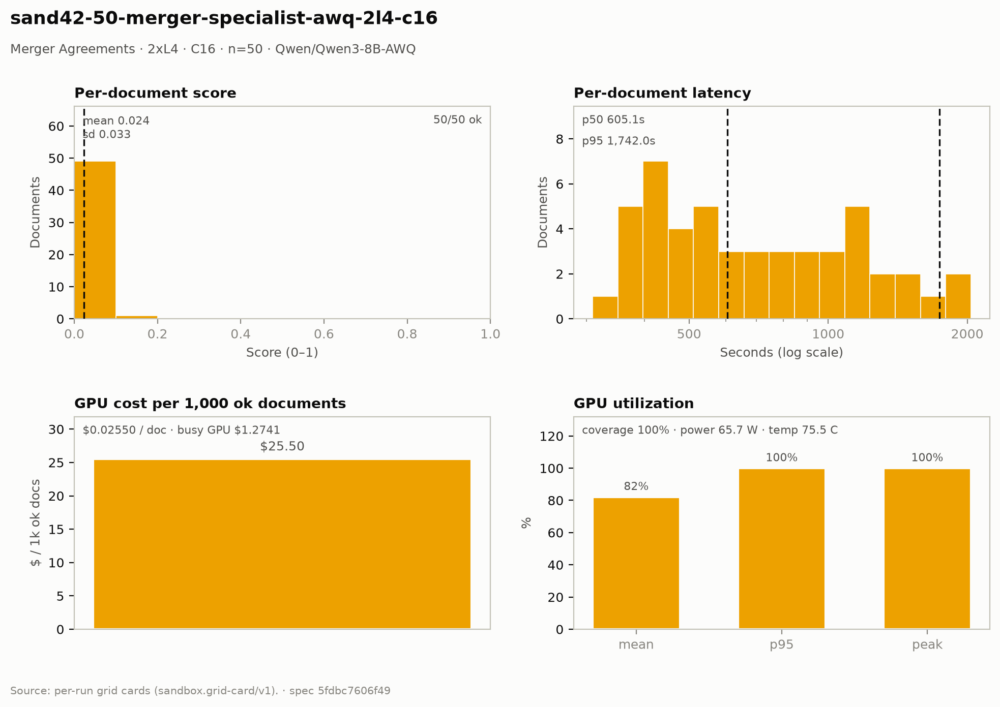

# Merger Agreements — 2× L4 · C16 · n=50

**Run:** `sand42-50-merger-specialist-awq-2l4-c16` · **Model:** Qwen/Qwen3-8B-AWQ · vLLM v0.29.0 · Modal `sandbox-vllm-b` · L4 @ $0.80/GPU-hr

## Conditions

| Condition | Value |
| --- | --- |
| Task | merger_agreement_specialist |
| Prompt | merger_agreement_specialist_simplified |
| Temperature | 0.7 (posture knob) |
| Output cap (max_tokens) | 6,144 |
| Input cap (max_input_chars) | 54,000 |
| top_p | 0.8 |
| top_k | 20 |
| presence_penalty | 1.0 |
| Length re-samples | 1 |
| Chunk window (chars) | 47000 |
| Chunk overlap (chars) | 6500 |
| Job retries | 2 |
| Dataset | Lucius-Morningstar/mailroom-dataset ground_truth @ ed7576b6, split=all, seed 42 |
| Draw | 50 docs (fingerprint aa4e596805e7) |
| Engine | awq_marlin · fp8 KV · CUDA graphs [1, 2, 4, 8, 16] · prefix caching on · thinking off |
| Admission | max_model_len 32768 · max_num_seqs 16 per replica · max_inputs 32 |

## Score & cost card

| Metric | Value |
| --- | ---: |
| **Run** |  |
| Run ID | `sand42-50-merger-specialist-awq-2l4-c16` |
| GPUs / replicas | 2 |
| Concurrency | 16 (8 per replica) |
| Documents | 50 |
| Spec hash | 5fdbc760… |
| **Time** |  |
| Wall (busy) | 2,866.64 s |
| GPU seconds | 2,868.42 s |
| Cold boot | 0.28 s |
| **Cost** |  |
| Busy-window GPU $ | $1.274062 |
| Billed GPU $ | $1.274855 |
| Billed seconds | 2,868.42 s |
| Idle $ | $0.186029 (418.56 s) |
| Cost per document | $0.025497 |
| Cost per ok document | $0.025497 |
| Cost per 1M tokens | $0.2467 |
| **Tokens** |  |
| Prompt tokens | 4,867,606 |
| Completion tokens | 299,988 (5.8%) |
| Total tokens | 5,167,594 |
| Tokens per document | 103,352 |
| Per document: instructions + template | 6,178 (6.0%) |
| Per document: document text | 91,174 (88.2%) |
| Per document: output | 6,000 (5.8%) |
| Instruction tokens per model call | 750 over 412 calls |
| Token split basis | document chars ÷ 4.5 chars/token; instructions are the remainder |
| Completion p95 / max (ok docs) | 8,358 / 9,846 |
| **Throughput** |  |
| Tokens / second | 1,802.7 |
| Tokens / second per L4 | 901.3 |
| Documents / minute | 1.05 |
| **Latency (per document, ok rows)** |  |
| Mean | 783.38 s |
| p50 | 605.15 s |
| p95 | 1,742.01 s |
| Max | 2,036.55 s |
| **Engine (vLLM /metrics)** |  |
| Parallelism (Σ latency ÷ wall) | 13.66× of 16 |
| Slot occupancy | 85.4% |
| Coverage | replicas observed: 2 of 2 |
| Requests per replica (this run) | 225 / 212 |
| Mean TTFT per replica | 4.340 s / 3.526 s |
| Prefix-cache hit per replica | 17.8% / 19.8% |
| Preemptions per replica (this run) | 0 / 0 |
| Length-capped finishes per replica (this run) | 9 / 3 |
| **GPU hardware (nvidia-smi)** | 962 samples · serving-replica nvidia-smi |
| GPU utilization | 82.2 % mean (p95 100.0 / peak 100.0 / min 0.0) |
| Sampling coverage | 99.6 % |
| GPU power draw | 65.7 W (min 30.0 / max 74.9) of 72 W cap |
| GPU memory bandwidth | 69.0 % (min 0.0 / max 100.0) |
| GPU SM clock | 1,413 MHz (min 930 / max 2,040) |
| GPU temperature | 75.5 C (min 54.0 / max 83.0) |
| GPU memory used | 19,996 MiB (min 19,992 / max 19,996) |
| **Quality** |  |
| Overall extraction score | 0.0237 (sd 0.033) |
| Score min / max | 0.0000 / 0.1333 |
| Scoring method | `suite+maud` |
| Schema-valid rate | 1.00 |
| Parse errors | 0 |
| Errors | 0 / 50 |
| **Clause scoring (MAUD)** |  |
| Questions answered / labeled | 349 / 811 (43.0%) |
| Micro accuracy | 2.3% |
| Precision on answered | 5.4% |
| Clean subset | 18 / 343 |
| Suite field score (mean) | not captured |

## Figure

## Per-document results

| # | Document | OK | Score | Latency (s) | Prompt tok | Completion tok | Error |
| ---: | --- | --- | ---: | ---: | ---: | ---: | --- |
| 1 | `DOC-0a733ab86f2390ae` | yes | 0.1333 | 361.8 | 81545 | 4231 | — |
| 2 | `DOC-4f45bef14dcd1dbf` | yes | 0.0625 | 404.4 | 70774 | 4473 | — |
| 3 | `DOC-eb2b56fe30dc35f4` | yes | 0.0588 | 411.9 | 85298 | 4548 | — |
| 4 | `DOC-5f5d40f6b2c338ac` | yes | 0.0000 | 440.5 | 109887 | 5604 | — |
| 5 | `DOC-d4b1a7a2b981fbf4` | yes | 0.0588 | 497.8 | 81817 | 5563 | — |
| 6 | `DOC-e8538f75b0f993e6` | yes | 0.0000 | 554.8 | 113280 | 6322 | — |
| 7 | `DOC-26933c93d649fa3f` | yes | 0.0000 | 573.5 | 96354 | 5635 | — |
| 8 | `DOC-dc7f18df501aec90` | yes | 0.0000 | 589.4 | 83008 | 5823 | — |
| 9 | `DOC-c96b9c7e12f91576` | yes | 0.0000 | 594.2 | 92490 | 6330 | — |
| 10 | `DOC-71bc59dd305ee8ed` | yes | 0.0769 | 697.2 | 109675 | 9846 | — |
| 11 | `DOC-52f9a5be69429299` | yes | 0.0000 | 711.7 | 103918 | 6922 | — |
| 12 | `DOC-30eda1e78a5f6fb5` | yes | 0.0000 | 749.6 | 107499 | 6707 | — |
| 13 | `DOC-b03c0d2bbbb9659e` | yes | 0.0000 | 809.7 | 113393 | 8205 | — |
| 14 | `DOC-511062d64bc9afc6` | yes | 0.0000 | 499.9 | 97584 | 5178 | — |
| 15 | `DOC-1e016055aa435e71` | yes | 0.0000 | 467.7 | 109137 | 6266 | — |
| 16 | `DOC-37bc3c44ae2c4ef6` | yes | 0.0000 | 930.1 | 90012 | 5683 | — |
| 17 | `DOC-f90cc5fb2ceac154` | yes | 0.0000 | 1,196.4 | 93747 | 6964 | — |
| 18 | `DOC-0534799ed39ca0db` | yes | 0.0000 | 1,109.8 | 92828 | 5957 | — |
| 19 | `DOC-5f8ef95caa2fd349` | yes | 0.0000 | 1,293.1 | 104105 | 7992 | — |
| 20 | `DOC-ab5578f1f9f04244` | yes | 0.0000 | 1,311.7 | 132059 | 8691 | — |
| 21 | `DOC-bec74557186e9409` | yes | 0.0000 | 1,172.9 | 78918 | 5326 | — |
| 22 | `DOC-9420b777a4b0784c` | yes | 0.0000 | 1,742.0 | 98627 | 5736 | — |
| 23 | `DOC-fe9a8b51344d67d9` | yes | 0.0000 | 1,152.6 | 130099 | 6891 | — |
| 24 | `DOC-c6b5f7ea5f718c28` | yes | 0.0000 | 970.5 | 82765 | 4644 | — |
| 25 | `DOC-297745a521cd1e8c` | yes | 0.0000 | 1,081.2 | 103150 | 7532 | — |
| 26 | `DOC-386ac6d669b7731c` | yes | 0.0769 | 1,040.4 | 93831 | 4997 | — |
| 27 | `DOC-45f801408be08af6` | yes | 0.0000 | 1,947.9 | 109920 | 8358 | — |
| 28 | `DOC-882fabf7aba36941` | yes | 0.0000 | 2,036.6 | 92325 | 7169 | — |
| 29 | `DOC-63beb09b179ea4ee` | yes | 0.0588 | 1,479.6 | 83572 | 5397 | — |
| 30 | `DOC-72b0b8c8385edd48` | yes | 0.0556 | 1,108.7 | 84431 | 5535 | — |
| 31 | `DOC-fcaddb5bdc94ce63` | yes | 0.0588 | 361.5 | 82656 | 4177 | — |
| 32 | `DOC-26fa94f698c37fc5` | yes | 0.0588 | 388.9 | 79931 | 4441 | — |
| 33 | `DOC-ac48214468deb8dd` | yes | 0.0588 | 384.5 | 72887 | 4330 | — |
| 34 | `DOC-0070a4e34dddbfd5` | yes | 0.0000 | 459.5 | 85209 | 5004 | — |
| 35 | `DOC-9d34581755c603a3` | yes | 0.0000 | 426.6 | 94942 | 4982 | — |
| 36 | `DOC-2b9f668ab6cb8901` | yes | 0.0526 | 1,545.3 | 90831 | 5570 | — |
| 37 | `DOC-1cd38a83b224335d` | yes | 0.0000 | 309.1 | 78294 | 3481 | — |
| 38 | `DOC-e6c8852b877c4598` | yes | 0.0556 | 563.8 | 104093 | 6809 | — |
| 39 | `DOC-b3d0149fd994357a` | yes | 0.0588 | 437.2 | 78500 | 5818 | — |
| 40 | `DOC-ab735131c00271bc` | yes | 0.0000 | 323.0 | 81228 | 4416 | — |
| 41 | `DOC-f9870e3b8fd141b0` | yes | 0.0000 | 661.4 | 134889 | 7406 | — |
| 42 | `DOC-169bbcdc5d9e609c` | yes | 0.0769 | 538.1 | 134911 | 6449 | — |
| 43 | `DOC-f449b47c7269f288` | yes | 0.0625 | 369.8 | 95394 | 4907 | — |
| 44 | `DOC-7e2818ceb0167d5a` | yes | 0.0556 | 850.2 | 78432 | 5151 | — |
| 45 | `DOC-f09307ad314d386f` | yes | 0.0000 | 406.6 | 103329 | 6486 | — |
| 46 | `DOC-03712a2b0a99a314` | yes | 0.0000 | 903.7 | 119367 | 5692 | — |
| 47 | `DOC-5d30efc302f3c431` | yes | 0.0625 | 525.0 | 130943 | 7902 | — |
| 48 | `DOC-23f224263f6974c5` | yes | 0.0000 | 401.9 | 83736 | 7148 | — |
| 49 | `DOC-681bc6115b882191` | yes | 0.0000 | 616.1 | 120554 | 5715 | — |
| 50 | `DOC-ff3ceb691481f1bd` | yes | 0.0000 | 759.3 | 91432 | 5579 | — |

_Generated 2026-10-12T17:17:21+00:00 by `sandbox run card`. Machine-readable twin: `sand42-50-merger-specialist-awq-2l4-c16.card.json`._
