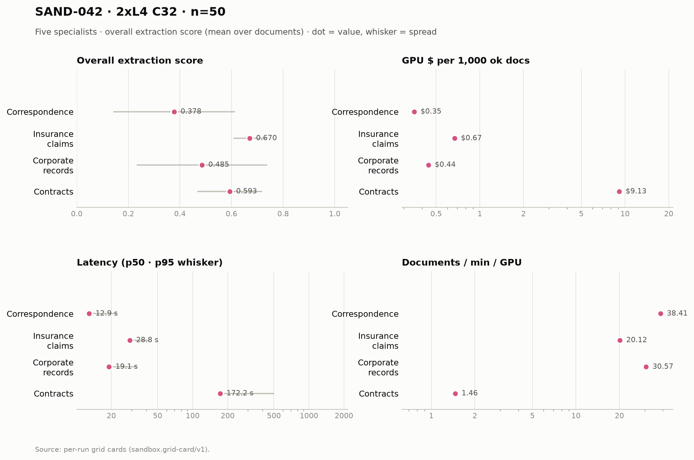

# SAND-042 · 2× L4 · client concurrency 32 (16 per replica) · n=50 × 5 specialists

**Cells reported:** 5 of 5 · **Runbook:** `sand42-2l4-c32` · **Model:** Qwen/Qwen3-8B-AWQ · L4 @ $0.80/GPU-hr

## Shared conditions

| Condition | Value |
| --- | --- |
| Engine | — · max_model_len 32768 · max_num_seqs 16/replica · max_inputs 32 |
| Fleet | 2 replica(s) · client concurrency 32 (16 per replica) |
| Dataset | `Lucius-Morningstar/mailroom-dataset` ground_truth @ ed7576b6, split=all, seed 42, one class bucket, 50 per class stratified over every subclass (min 1 per sub-type) |
| Prompt | v1 `*_simplified` stems only |
| Output cap | max_tokens 8,192 · temperature 0.7 contracts + merger, 0.1 elsewhere |
| GPU telemetry | in-container nvidia-smi series, label `sand42-2l4-c32` |

## Per specialist

| Metric | Correspondence | Insurance Claims | Corporate Records | Contracts | Merger Agreements |
| --- | ---: | ---: | ---: | ---: | ---: |
| Quality (95% CI) | 0.378 [0.312, 0.443] | 0.670 [0.654, 0.688] | 0.485 [0.412, 0.555] | 0.593 [0.555, 0.628] | 0.024 [0.016, 0.032] |
| Scored documents | 50 | 50 | 50 | 45 | 50 |
| Quality SD | 0.236 | 0.062 | 0.253 | 0.126 | 0.030 |
| Scoring method | suite | suite | suite | suite+cuad | suite+maud |
| Clause metric | — | — | — | CUAD F1 0.593 · 45 labeled | MAUD acc 2.5% · 267/811 answered |
| Ok rate (Wilson) | 50/50 100.0% [0.929, 1.000] | 50/50 100.0% [0.929, 1.000] | 50/50 100.0% [0.929, 1.000] | 50/50 100.0% [0.929, 1.000] | 50/50 100.0% [0.929, 1.000] |
| Schema-valid rate | 100.0% | 30.0% | 96.0% | 100.0% | 100.0% |
| Parse errors | 0 | 0 | 0 | 0 | 0 |
| Length-capped | 0 | 0 | 0 | 0 | 0 |
| Error kinds | — | — | — | — | — |
| p50 latency (s) | 12.9 | 28.8 | 19.1 | 172.2 | 987.5 |
| p95 latency (s) | 22.3 | 42.4 | 33.3 | 502.4 | 1,685.6 |
| SLO (s) · met | 60 · yes | 60 · yes | 60 · yes | 300 · no | 1,800 · yes |
| Documents/min | 76.82 | 40.24 | 61.14 | 2.92 | 1.52 |
| Documents/min/GPU | 38.41 | 20.12 | 30.57 | 1.46 | 0.76 |
| Goodput docs/min/GPU | 38.41 | 20.12 | 30.57 | 0.00 | 0.76 |
| Tokens/s/GPU | 1,756.5 | 1,246.4 | 2,091.8 | 436.5 | 1,313.0 |
| Mean TTFT (s) | 3.39 | 4.73 | 5.64 | 11.26 | 23.37 |
| Prefix-cache hit | 61.7% | 55.1% | 48.3% | 37.1% | 16.9% |
| Wall (s) | 39.1 | 74.6 | 49.1 | 1,026.4 | 1,972.3 |
| Billed GPU $ (run) | $0.0176 | $0.0335 | $0.0221 | $0.4563 | $0.8767 |
| $ / 1k ok docs | $0.352680 | $0.669460 | $0.442320 | $9.125560 | $17.534160 |
| $ / 1k schema-valid | $0.352680 | $2.231533 | $0.460750 | $9.125560 | $17.534160 |
| $ / doc | $0.000353 | $0.000669 | $0.000442 | $0.009126 | $0.017534 |
| $ / ok doc | $0.000353 | $0.000669 | $0.000442 | $0.009126 | $0.017534 |
| $ / 1M tokens | $0.129 | $0.180 | $0.108 | $0.509 | $0.169 |
| GPU util (mean/p95/min–max) | 62.3% mean / 100.0 p95 / 0.0–100.0% min–max (n=11) | 75.6% mean / 100.0 p95 / 0.0–100.0% min–max (n=22) | 68.6% mean / 100.0 p95 / 0.0–100.0% min–max (n=13) | 83.1% mean / 100.0 p95 / 0.0–100.0% min–max (n=313) | 94.8% mean / 100.0 p95 / 0.0–100.0% min–max (n=596) |
| GPU mem used (mean) | 20,981 MiB (91.1% of 23,034) | 21,023 MiB (91.3% of 23,034) | 21,023 MiB (91.3% of 23,034) | 21,027 MiB (91.3% of 23,034) | 21,027 MiB (91.3% of 23,034) |
| GPU mem bandwidth (mean) | 54.5% mean | 70.3% mean | 49.4% mean | 79.8% mean | 74.8% mean |
| Sampling coverage | 100.0% | 100.0% | 86.2% ⚠ below the 90% gate (issue #128) | 97.0% | 99.4% |
| GPU power (W, mean) | 57.2 | 64.6 | 60.0 | 66.1 | 70.1 |
| GPU temp (C, mean) | 67.5 | 74.6 | 76.4 | 76.0 | 75.8 |
| KV cache use (%) | 0 (drained-edge sample: the scrapes fire before/after the run, when the cache is empty by construction; a mid-run sample is the only real source) | 0 (drained-edge sample: the scrapes fire before/after the run, when the cache is empty by construction; a mid-run sample is the only real source) | 0 (drained-edge sample: the scrapes fire before/after the run, when the cache is empty by construction; a mid-run sample is the only real source) | 0 (drained-edge sample: the scrapes fire before/after the run, when the cache is empty by construction; a mid-run sample is the only real source) | 0 (drained-edge sample: the scrapes fire before/after the run, when the cache is empty by construction; a mid-run sample is the only real source) |
| KV cache use, mid-run (max %) | — | — | — | — | 99.0% |
| Queue depth, mid-run (running/waiting) | — | — | — | — | 16 running / 10 waiting |
| Preemptions | 0 | 0 | 0 | 0 | 0 |
| Length finishes | 0 | 0 | 0 | 3 | 4 |

## Figure

## Cost (computed from the session)

The fleet is pinned warm (`min_containers=1`) from deploy to teardown, so Modal meters the **whole window** — the cold boot and the idle between specialists included. This is computed from the session's own timestamps, not scraped from the billing CLI (whose figures are credits-based and workspace-wide).

| Fleet cost | Value |
| --- | ---: |
| Replicas × GPU | 2 × L4 @ $0.80/GPU-hr |
| Cold boot (deploy → ready) | 217.0 s |
| Fleet window (deploy → teardown) | 3,471.0 s |
| Fleet GPU-hours | 1.9283 |
| **Fleet GPU $** | **$1.5427** |
| Of which the five runs | 3,164.0 s (91.2%) |
| Boot + idle overhead | 307.0 s |

## Per-run cards

| Specialist | Run ID | Card |
| --- | --- | --- |
| Correspondence | `sand42-50-correspondence-specialist-awq-2l4-c32` | [sand42-50-correspondence-specialist-awq-2l4-c32.card.md](correspondence/sand42-50-correspondence-specialist-awq-2l4-c32.card.md) |
| Insurance Claims | `sand42-50-insurance-claims-specialist-awq-2l4-c32` | [sand42-50-insurance-claims-specialist-awq-2l4-c32.card.md](insurance_claims/sand42-50-insurance-claims-specialist-awq-2l4-c32.card.md) |
| Corporate Records | `sand42-50-corporate-records-specialist-awq-2l4-c32` | [sand42-50-corporate-records-specialist-awq-2l4-c32.card.md](corporate_records/sand42-50-corporate-records-specialist-awq-2l4-c32.card.md) |
| Contracts | `sand42-50-contracts-specialist-awq-2l4-c32` | [sand42-50-contracts-specialist-awq-2l4-c32.card.md](contracts/sand42-50-contracts-specialist-awq-2l4-c32.card.md) |
| Merger Agreements | `sand42-50-merger-specialist-awq-2l4-c32` | [sand42-50-merger-specialist-awq-2l4-c32.card.md](merger_agreement/sand42-50-merger-specialist-awq-2l4-c32.card.md) |

_Merger dominates pooled throughput (≈ 112k prompt tokens per agreement on the frozen settings), so no pooled column is reported here — compare per class._

_Generated 2026-10-12T17:48:53+00:00 by `sandbox run card --runbook sand42-2l4-c32` from the committed per-run `*.card.json`._
