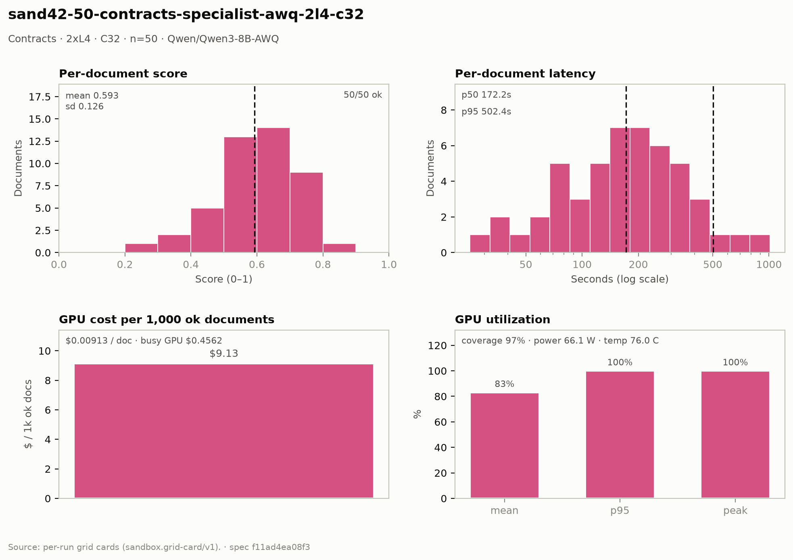

# Contracts — 2× L4 · C32 · n=50

**Run:** `sand42-50-contracts-specialist-awq-2l4-c32` · **Model:** Qwen/Qwen3-8B-AWQ · vLLM v0.29.0 · Modal `sandbox-vllm` · L4 @ $0.80/GPU-hr

## Conditions

| Condition | Value |
| --- | --- |
| Task | contracts_specialist |
| Prompt | contracts_specialist_v33_simplified |
| Temperature | 0.7 (posture knob) |
| Output cap (max_tokens) | 8,192 |
| Input cap (max_input_chars) | 49,000 |
| Chunk window (chars) | 43000 |
| Chunk overlap (chars) | 6000 |
| Job retries | 2 |
| Dataset | Lucius-Morningstar/mailroom-dataset ground_truth @ ed7576b6, split=all, seed 42 |
| Draw | 50 docs (fingerprint 83eb6b1f2c7e) |
| Engine | awq_marlin · fp8 KV · CUDA graphs [1, 2, 4, 8, 16] · prefix caching on · thinking off |
| Admission | max_model_len 32768 · max_num_seqs 16 per replica · max_inputs 32 |

## Score & cost card

| Metric | Value |
| --- | ---: |
| **Run** |  |
| Run ID | `sand42-50-contracts-specialist-awq-2l4-c32` |
| GPUs / replicas | 2 |
| Concurrency | 32 (16 per replica) |
| Documents | 50 |
| Spec hash | f11ad4ea… |
| **Time** |  |
| Wall (busy) | 1,026.39 s |
| GPU seconds | 1,026.62 s |
| Cold boot | 0.21 s |
| **Cost** |  |
| Busy-window GPU $ | $0.456174 |
| Billed GPU $ | $0.456278 |
| Billed seconds | 1,026.62 s |
| Idle $ | $0.305251 (686.81 s) |
| Cost per document | $0.009126 |
| Cost per ok document | $0.009126 |
| Cost per 1M tokens | $0.5092 |
| **Tokens** |  |
| Prompt tokens | 765,208 |
| Completion tokens | 130,896 (14.6%) |
| Total tokens | 896,104 |
| Tokens per document | 17,922 |
| Per document: instructions + template | 3,629 (20.2%) |
| Per document: document text | 11,676 (65.1%) |
| Per document: output | 2,618 (14.6%) |
| Instruction tokens per model call | 2,134 over 85 calls |
| Token split basis | document chars ÷ 4.5 chars/token; instructions are the remainder |
| Completion p95 / max (ok docs) | 4,610 / 25,928 |
| **Throughput** |  |
| Tokens / second | 873.1 |
| Tokens / second per L4 | 436.5 |
| Documents / minute | 2.92 |
| **Latency (per document, ok rows)** |  |
| Mean | 217.33 s |
| p50 | 172.15 s |
| p95 | 502.43 s |
| Max | 1,011.81 s |
| **Engine (vLLM /metrics)** |  |
| Parallelism (Σ latency ÷ wall) | 10.59× of 32 |
| Slot occupancy | 33.1% |
| Coverage | replicas observed: 2 of 2 |
| Requests per replica (this run) | 48 / 37 |
| Mean TTFT per replica | 19.021 s / 3.491 s |
| Prefix-cache hit per replica | 39.5% / 34.7% |
| Preemptions per replica (this run) | 0 / 0 |
| Length-capped finishes per replica (this run) | 1 / 2 |
| **GPU hardware (nvidia-smi)** | 313 samples · serving-replica nvidia-smi |
| GPU utilization | 83.1 % mean (p95 100.0 / peak 100.0 / min 0.0) |
| Sampling coverage | 97.0 % |
| GPU power draw | 66.1 W (min 32.1 / max 73.7) of 72 W cap |
| GPU memory bandwidth | 79.8 % (min 0.0 / max 100.0) |
| GPU SM clock | 1,488 MHz (min 1,020 / max 2,040) |
| GPU temperature | 76.0 C (min 69.0 / max 83.0) |
| GPU memory used | 21,027 MiB (min 21,022 / max 21,028) |
| **Quality** |  |
| Overall extraction score | 0.5929 (sd 0.126) |
| Score min / max | 0.2581 / 0.8182 |
| Scoring method | `suite+cuad` |
| Schema-valid rate | 1.00 |
| Parse errors | 0 |
| Errors | 0 / 50 |
| **Clause scoring (CUAD)** |  |
| Docs with CUAD labels | 45 |
| Micro precision / recall / F1 | 0.604 / 0.582 / 0.593 |
| Metadata value checks | 77 / 127 |
| Suite field score (mean) | not captured |
| **Paired n** |  |
| Documents a paired delta can use | 45 of 50 (5 with no ground truth for the class metric) |

## Figure

## Per-document results

| # | Document | OK | Score | Latency (s) | Prompt tok | Completion tok | Error |
| ---: | --- | --- | ---: | ---: | ---: | ---: | --- |
| 1 | `DOC-e4272758b561f8cd` | yes | 0.6429 | 66.0 | 6987 | 933 | — |
| 2 | `DOC-fc9671ccde642e8d` | yes | — | 68.0 | 7936 | 988 | — |
| 3 | `DOC-6b4cc54c8c4d796f` | yes | — | 75.5 | 4015 | 724 | — |
| 4 | `DOC-f5a54932794ef16e` | yes | 0.6667 | 78.3 | 5302 | 1140 | — |
| 5 | `DOC-385a86c69f8e562c` | yes | 0.6667 | 79.1 | 6560 | 1156 | — |
| 6 | `DOC-70f90b46b2c4f1a6` | yes | 0.7500 | 25.1 | 3154 | 505 | — |
| 7 | `DOC-a9850db362f57916` | yes | — | 103.9 | 6764 | 1078 | — |
| 8 | `DOC-6671a684f52f82a9` | yes | 0.6400 | 106.4 | 11320 | 1102 | — |
| 9 | `DOC-1e22a2d4068b8650` | yes | 0.7692 | 110.3 | 7587 | 1104 | — |
| 10 | `DOC-f8b0d4bcbac60ca2` | yes | 0.6000 | 116.0 | 3824 | 1204 | — |
| 11 | `DOC-035731e655e67aab` | yes | 0.5000 | 121.3 | 5207 | 2027 | — |
| 12 | `DOC-03529267ee75444d` | yes | 0.5806 | 131.6 | 10583 | 1370 | — |
| 13 | `DOC-e998c563b82122b9` | yes | 0.5263 | 140.3 | 10006 | 1493 | — |
| 14 | `DOC-27b649fe2f6fae8e` | yes | 0.6667 | 151.6 | 5464 | 1566 | — |
| 15 | `DOC-186145066ab191fa` | yes | 0.3636 | 50.6 | 3718 | 867 | — |
| 16 | `DOC-0812d9d3e2b1baa0` | yes | 0.4706 | 162.2 | 18679 | 2282 | — |
| 17 | `DOC-81c4ce12d907380c` | yes | 0.7200 | 164.0 | 7047 | 1774 | — |
| 18 | `DOC-e0d31c39359cb803` | yes | 0.6667 | 35.6 | 6879 | 495 | — |
| 19 | `DOC-3c07c9ccd9a01d6e` | yes | 0.7368 | 173.7 | 7428 | 2894 | — |
| 20 | `DOC-fe06800cc62e5e19` | yes | 0.5091 | 81.5 | 8619 | 1416 | — |
| 21 | `DOC-b1aba7df0380a1b2` | yes | — | 189.9 | 5032 | 958 | — |
| 22 | `DOC-593f2c6de770b84c` | yes | 0.6667 | 199.4 | 9228 | 1106 | — |
| 23 | `DOC-4b57f485708ab60b` | yes | 0.6000 | 66.0 | 6639 | 1260 | — |
| 24 | `DOC-01849fa3020a5ac1` | yes | 0.5000 | 39.4 | 4173 | 923 | — |
| 25 | `DOC-f45b328fd8a54c8b` | yes | 0.5882 | 93.5 | 4608 | 1786 | — |
| 26 | `DOC-e235bc9735f96335` | yes | 0.7222 | 222.4 | 10699 | 2510 | — |
| 27 | `DOC-812192e392d8d410` | yes | 0.6000 | 237.1 | 5551 | 2607 | — |
| 28 | `DOC-62b300182901e850` | yes | 0.4286 | 170.6 | 33346 | 3483 | — |
| 29 | `DOC-1ddc9333769d27e4` | yes | 0.5333 | 163.6 | 4450 | 1051 | — |
| 30 | `DOC-8f737e9fec8f24f0` | yes | 0.5000 | 166.9 | 35815 | 3480 | — |
| 31 | `DOC-9a36838df2878b37` | yes | 0.6667 | 249.9 | 8142 | 2715 | — |
| 32 | `DOC-b83763aeff114369` | yes | 0.6429 | 263.8 | 7446 | 2096 | — |
| 33 | `DOC-9cee2e10b449a71c` | yes | 0.7097 | 288.6 | 21752 | 2640 | — |
| 34 | `DOC-472f423cdf0819ef` | yes | 0.5714 | 195.1 | 4656 | 1191 | — |
| 35 | `DOC-c9d4c4f8ff433527` | yes | 0.5217 | 189.6 | 7730 | 1118 | — |
| 36 | `DOC-b87880882e5fe354` | yes | — | 314.8 | 19278 | 3613 | — |
| 37 | `DOC-dfb4e69a3ab10dc9` | yes | 0.4000 | 224.2 | 7378 | 1735 | — |
| 38 | `DOC-4fb6419e37bff201` | yes | 0.6897 | 325.7 | 22234 | 3380 | — |
| 39 | `DOC-8993ad1085e08bd0` | yes | 0.7778 | 277.6 | 22402 | 2341 | — |
| 40 | `DOC-2b510409d3b9a4a6` | yes | 0.6452 | 358.9 | 21668 | 4113 | — |
| 41 | `DOC-0752e0811f5f5eb7` | yes | 0.4211 | 378.2 | 41619 | 4610 | — |
| 42 | `DOC-1266801f2faad19f` | yes | 0.5000 | 379.0 | 33383 | 4191 | — |
| 43 | `DOC-dbe52fd78e44b0ef` | yes | 0.8182 | 224.8 | 18750 | 2316 | — |
| 44 | `DOC-73055dbb1e9f5f2f` | yes | 0.3704 | 393.7 | 49409 | 4488 | — |
| 45 | `DOC-be1eccde5bae9c82` | yes | 0.4762 | 272.0 | 9330 | 3632 | — |
| 46 | `DOC-e218d39bb2f3c5ef` | yes | 0.5385 | 305.6 | 19923 | 4400 | — |
| 47 | `DOC-dfd20f94bb76b6e4` | yes | 0.7200 | 334.6 | 11041 | 1807 | — |
| 48 | `DOC-712c3f92a0a56b77` | yes | 0.5517 | 502.4 | 56227 | 7326 | — |
| 49 | `DOC-e29140d2e8e989be` | yes | 0.2581 | 786.0 | 21229 | 1974 | — |
| 50 | `DOC-53e364f030a30b5c` | yes | 0.7879 | 1,011.8 | 94991 | 25928 | — |

_Generated 2026-10-12T22:59:11+00:00 by `sandbox run card`. Machine-readable twin: `sand42-50-contracts-specialist-awq-2l4-c32.card.json`._
