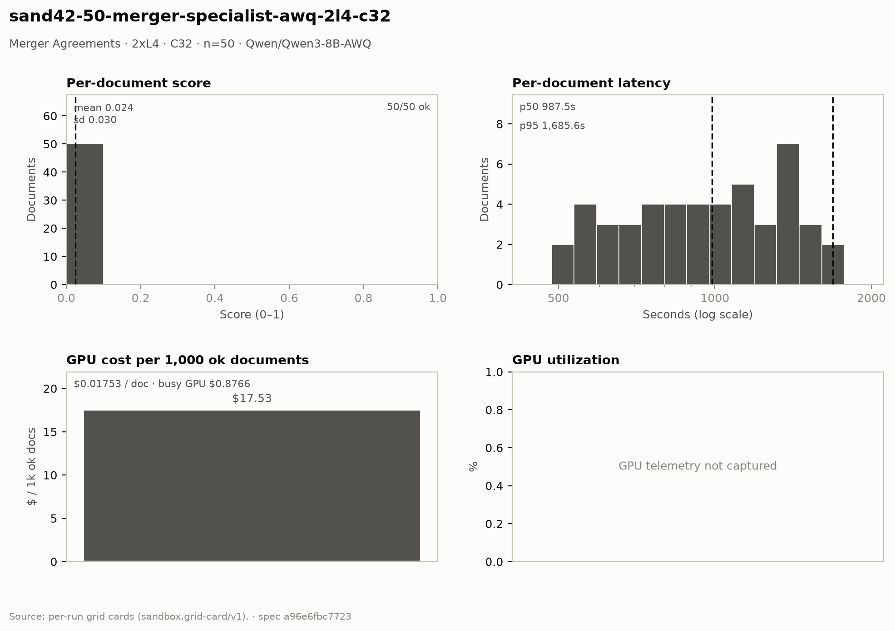

# Merger Agreements — 2× L4 · C32 · n=50

**Run:** `sand42-50-merger-specialist-awq-2l4-c32` · **Model:** Qwen/Qwen3-8B-AWQ · vLLM v0.29.0 · Modal `sandbox-vllm` · L4 @ $0.80/GPU-hr

## Conditions

| Condition | Value |
| --- | --- |
| Task | merger_agreement_specialist |
| Prompt | merger_agreement_specialist_simplified |
| Temperature | 0.7 (posture knob) |
| Output cap (max_tokens) | 6,144 |
| Input cap (max_input_chars) | 54,000 |
| top_p | 0.8 |
| top_k | 20 |
| presence_penalty | 1.0 |
| Length re-samples | 1 |
| Chunk window (chars) | 47000 |
| Chunk overlap (chars) | 6500 |
| Job retries | 2 |
| Dataset | Lucius-Morningstar/mailroom-dataset ground_truth @ ed7576b6, split=all, seed 42 |
| Draw | 50 docs (fingerprint aa4e596805e7) |
| Engine | awq_marlin · fp8 KV · CUDA graphs [1, 2, 4, 8, 16] · prefix caching on · thinking off |
| Admission | max_model_len 32768 · max_num_seqs 16 per replica · max_inputs 32 |

## Score & cost card

| Metric | Value |
| --- | ---: |
| **Run** |  |
| Run ID | `sand42-50-merger-specialist-awq-2l4-c32` |
| GPUs / replicas | 2 |
| Concurrency | 32 (16 per replica) |
| Documents | 50 |
| Spec hash | a96e6fbc… |
| **Time** |  |
| Wall (busy) | 1,972.33 s |
| GPU seconds | 1,972.57 s |
| Cold boot | 0.24 s |
| **Cost** |  |
| Busy-window GPU $ | $0.876590 |
| Billed GPU $ | $0.876696 |
| Billed seconds | 1,972.57 s |
| Idle $ | $0.164500 (370.12 s) |
| Cost per document | $0.017534 |
| Cost per ok document | $0.017534 |
| Cost per 1M tokens | $0.1693 |
| **Tokens** |  |
| Prompt tokens | 4,867,606 |
| Completion tokens | 311,760 (6.0%) |
| Total tokens | 5,179,366 |
| Tokens per document | 103,587 |
| Per document: instructions + template | 6,178 (6.0%) |
| Per document: document text | 91,174 (88.0%) |
| Per document: output | 6,235 (6.0%) |
| Instruction tokens per model call | 750 over 412 calls |
| Token split basis | document chars ÷ 4.5 chars/token; instructions are the remainder |
| Completion p95 / max (ok docs) | 9,346 / 11,167 |
| **Throughput** |  |
| Tokens / second | 2,626.0 |
| Tokens / second per L4 | 1,313.0 |
| Documents / minute | 1.52 |
| **Latency (per document, ok rows)** |  |
| Mean | 1,025.41 s |
| p50 | 987.54 s |
| p95 | 1,685.64 s |
| Max | 1,959.19 s |
| **Engine (vLLM /metrics)** |  |
| Parallelism (Σ latency ÷ wall) | 25.99× of 32 |
| Slot occupancy | 81.2% |
| Coverage | not captured |
| Requests per replica (this run) | not captured |
| Mean TTFT per replica | not captured |
| Prefix-cache hit per replica | not captured |
| Preemptions per replica (this run) | not captured |
| Length-capped finishes per replica (this run) | not captured |
| **GPU hardware (nvidia-smi)** | not captured |
| **Quality** |  |
| Overall extraction score | 0.0241 (sd 0.030) |
| Score min / max | 0.0000 / 0.0769 |
| Scoring method | `suite+maud` |
| Schema-valid rate | 1.00 |
| Parse errors | 0 |
| Errors | 0 / 50 |
| **Clause scoring (MAUD)** |  |
| Questions answered / labeled | 267 / 811 (32.9%) |
| Micro accuracy | 2.5% |
| Precision on answered | 7.5% |
| Clean subset | 19 / 343 |
| Suite field score (mean) | not captured |

## Figure

## Per-document results

| # | Document | OK | Score | Latency (s) | Prompt tok | Completion tok | Error |
| ---: | --- | --- | ---: | ---: | ---: | ---: | --- |
| 1 | `DOC-bec74557186e9409` | yes | 0.0000 | 439.0 | 78918 | 4770 | — |
| 2 | `DOC-63beb09b179ea4ee` | yes | 0.0588 | 580.0 | 83572 | 5467 | — |
| 3 | `DOC-dc7f18df501aec90` | yes | 0.0000 | 619.7 | 83008 | 4764 | — |
| 4 | `DOC-7e2818ceb0167d5a` | yes | 0.0556 | 662.6 | 78432 | 4139 | — |
| 5 | `DOC-2b9f668ab6cb8901` | yes | 0.0526 | 712.0 | 90831 | 4562 | — |
| 6 | `DOC-eb2b56fe30dc35f4` | yes | 0.0000 | 781.6 | 85298 | 4751 | — |
| 7 | `DOC-4f45bef14dcd1dbf` | yes | 0.0625 | 781.8 | 70774 | 4117 | — |
| 8 | `DOC-30eda1e78a5f6fb5` | yes | 0.0000 | 798.2 | 107499 | 5809 | — |
| 9 | `DOC-f90cc5fb2ceac154` | yes | 0.0000 | 880.2 | 93747 | 4382 | — |
| 10 | `DOC-26933c93d649fa3f` | yes | 0.0625 | 919.4 | 96354 | 4471 | — |
| 11 | `DOC-0a733ab86f2390ae` | yes | 0.0000 | 1,021.2 | 81545 | 5041 | — |
| 12 | `DOC-72b0b8c8385edd48` | yes | 0.0556 | 1,027.0 | 84431 | 4372 | — |
| 13 | `DOC-9420b777a4b0784c` | yes | 0.0000 | 1,050.6 | 98627 | 6040 | — |
| 14 | `DOC-1e016055aa435e71` | yes | 0.0000 | 1,102.2 | 109137 | 6989 | — |
| 15 | `DOC-5f5d40f6b2c338ac` | yes | 0.0000 | 1,136.1 | 109887 | 5080 | — |
| 16 | `DOC-c6b5f7ea5f718c28` | yes | 0.0000 | 1,141.3 | 82765 | 5217 | — |
| 17 | `DOC-52f9a5be69429299` | yes | 0.0588 | 1,181.3 | 103918 | 9120 | — |
| 18 | `DOC-37bc3c44ae2c4ef6` | yes | 0.0000 | 1,245.4 | 90012 | 6263 | — |
| 19 | `DOC-d4b1a7a2b981fbf4` | yes | 0.0000 | 1,285.4 | 81817 | 5661 | — |
| 20 | `DOC-e8538f75b0f993e6` | yes | 0.0000 | 1,354.1 | 113280 | 6935 | — |
| 21 | `DOC-297745a521cd1e8c` | yes | 0.0000 | 1,355.4 | 103150 | 8588 | — |
| 22 | `DOC-0534799ed39ca0db` | yes | 0.0556 | 1,357.4 | 92828 | 7667 | — |
| 23 | `DOC-b03c0d2bbbb9659e` | yes | 0.0000 | 1,394.1 | 113393 | 5383 | — |
| 24 | `DOC-fe9a8b51344d67d9` | yes | 0.0000 | 1,394.0 | 130099 | 6948 | — |
| 25 | `DOC-882fabf7aba36941` | yes | 0.0000 | 1,398.4 | 92325 | 6654 | — |
| 26 | `DOC-b3d0149fd994357a` | yes | 0.0588 | 519.3 | 78500 | 4294 | — |
| 27 | `DOC-0070a4e34dddbfd5` | yes | 0.0000 | 727.5 | 85209 | 6591 | — |
| 28 | `DOC-c96b9c7e12f91576` | yes | 0.0000 | 1,447.7 | 92490 | 6033 | — |
| 29 | `DOC-03712a2b0a99a314` | yes | 0.0588 | 1,021.8 | 119367 | 6805 | — |
| 30 | `DOC-ab5578f1f9f04244` | yes | 0.0000 | 1,551.2 | 132059 | 8612 | — |
| 31 | `DOC-5f8ef95caa2fd349` | yes | 0.0000 | 1,592.3 | 104105 | 9346 | — |
| 32 | `DOC-386ac6d669b7731c` | yes | 0.0769 | 1,593.5 | 93831 | 7563 | — |
| 33 | `DOC-9d34581755c603a3` | yes | 0.0000 | 816.8 | 94942 | 5906 | — |
| 34 | `DOC-fcaddb5bdc94ce63` | yes | 0.0588 | 953.8 | 82656 | 4955 | — |
| 35 | `DOC-ac48214468deb8dd` | yes | 0.0588 | 841.7 | 72887 | 5621 | — |
| 36 | `DOC-1cd38a83b224335d` | yes | 0.0588 | 617.5 | 78294 | 4919 | — |
| 37 | `DOC-f449b47c7269f288` | yes | 0.0625 | 572.0 | 95394 | 4471 | — |
| 38 | `DOC-ab735131c00271bc` | yes | 0.0556 | 656.6 | 81228 | 4460 | — |
| 39 | `DOC-45f801408be08af6` | yes | 0.0000 | 1,685.6 | 109920 | 11167 | — |
| 40 | `DOC-71bc59dd305ee8ed` | yes | 0.0769 | 1,711.3 | 109675 | 6728 | — |
| 41 | `DOC-f09307ad314d386f` | yes | 0.0000 | 579.9 | 103329 | 5740 | — |
| 42 | `DOC-e6c8852b877c4598` | yes | 0.0556 | 937.1 | 104093 | 7836 | — |
| 43 | `DOC-ff3ceb691481f1bd` | yes | 0.0000 | 607.0 | 91432 | 6251 | — |
| 44 | `DOC-681bc6115b882191` | yes | 0.0000 | 576.2 | 120554 | 5970 | — |
| 45 | `DOC-23f224263f6974c5` | yes | 0.0000 | 526.1 | 83736 | 5277 | — |
| 46 | `DOC-26fa94f698c37fc5` | yes | 0.0588 | 1,195.7 | 79931 | 5997 | — |
| 47 | `DOC-f9870e3b8fd141b0` | yes | 0.0000 | 1,167.8 | 134889 | 8463 | — |
| 48 | `DOC-169bbcdc5d9e609c` | yes | 0.0000 | 938.5 | 134911 | 7562 | — |
| 49 | `DOC-5d30efc302f3c431` | yes | 0.0625 | 855.8 | 130943 | 11157 | — |
| 50 | `DOC-511062d64bc9afc6` | yes | 0.0000 | 1,959.2 | 97584 | 6846 | — |

_Generated 2026-10-12T17:16:16+00:00 by `sandbox run card`. Machine-readable twin: `sand42-50-merger-specialist-awq-2l4-c32.card.json`._
