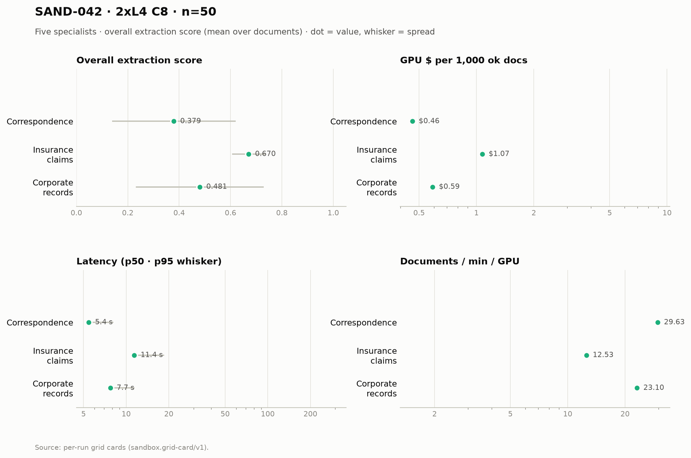

# SAND-042 · 2× L4 · client concurrency 8 (4 per replica) · n=50 × 5 specialists

**Cells reported:** 4 of 5 · **Runbook:** `sand42-2l4-c8` · **Model:** Qwen/Qwen3-8B-AWQ · L4 @ $0.80/GPU-hr

## Shared conditions

| Condition | Value |
| --- | --- |
| Engine | — · max_model_len 32768 · max_num_seqs 16/replica · max_inputs 32 |
| Fleet | 2 replica(s) · client concurrency 8 (4 per replica) |
| Dataset | `Lucius-Morningstar/mailroom-dataset` ground_truth @ ed7576b6, split=all, seed 42, one class bucket, 50 per class stratified over every subclass (min 1 per sub-type) |
| Prompt | v1 `*_simplified` stems only |
| Output cap | max_tokens 8,192 · temperature 0.7 contracts + merger, 0.1 elsewhere |
| GPU telemetry | in-container nvidia-smi series, label `sand42-2l4-c8` |

## Per specialist

| Metric | Correspondence | Insurance Claims | Corporate Records | Contracts | Merger Agreements |
| --- | ---: | ---: | ---: | ---: | ---: |
| Quality (95% CI) | 0.379 [0.310, 0.447] | 0.670 [0.653, 0.687] | 0.481 [0.412, 0.550] | 0.622 [0.581, 0.659] | not run |
| Scored documents | 50 | 50 | 50 | 44 | not run |
| Quality SD | 0.241 | 0.064 | 0.249 | 0.131 | not run |
| Scoring method | suite | suite | suite | suite+cuad | not run |
| Clause metric | — | — | — | CUAD F1 0.615 · 44 labeled | not run |
| Ok rate (Wilson) | 50/50 100.0% [0.929, 1.000] | 50/50 100.0% [0.929, 1.000] | 50/50 100.0% [0.929, 1.000] | 49/50 98.0% [0.895, 0.996] | not run |
| Schema-valid rate | 100.0% | 30.0% | 96.0% | 100.0% | not run |
| Parse errors | 0 | 0 | 0 | 0 | not run |
| Length-capped | 0 | 0 | 0 | 1 | not run |
| Error kinds | — | — | — | LengthFinishReasonError×1 | not run |
| p50 latency (s) | 5.4 | 11.4 | 7.7 | 76.5 | not run |
| p95 latency (s) | 8.1 | 18.6 | 11.5 | 293.0 | not run |
| SLO (s) · met | 60 · yes | 60 · yes | 60 · yes | 300 · yes | not run |
| Documents/min | 59.25 | 25.06 | 46.21 | 3.06 | not run |
| Documents/min/GPU | 59.25 | 25.06 | 46.21 | 3.06 | not run |
| Goodput docs/min/GPU | 29.63 | 12.53 | 23.10 | 1.53 | not run |
| Tokens/s/GPU | 1,356.4 | 777.6 | 1,581.2 | 445.6 | not run |
| Mean TTFT (s) | 0.60 | 0.68 | 0.86 | 1.57 | not run |
| Prefix-cache hit | 62.2% | 57.2% | 49.9% | 37.7% | not run |
| Wall (s) | 50.6 | 119.7 | 64.9 | 981.5 | not run |
| Billed GPU $ (run) | $0.0231 | $0.0536 | $0.0294 | $0.4367 | not run |
| $ / 1k ok docs | $0.461040 | $1.072720 | $0.588180 | $8.912980 | not run |
| $ / 1k schema-valid | $0.461040 | $3.575733 | $0.612688 | $8.734720 | not run |
| $ / doc | $0.000461 | $0.001073 | $0.000588 | $0.008735 | not run |
| $ / ok doc | $0.000461 | $0.001073 | $0.000588 | $0.008913 | not run |
| $ / 1M tokens | $0.168 | $0.288 | $0.143 | $0.499 | not run |
| GPU util (mean/p95/min–max) | 69.1% mean / 100.0 p95 / 0.0–100.0% min–max (n=17) | 75.3% mean / 100.0 p95 / 0.0–100.0% min–max (n=40) | 79.6% mean / 100.0 p95 / 0.0–100.0% min–max (n=21) | 84.2% mean / 100.0 p95 / 0.0–100.0% min–max (n=333) | not run |
| GPU mem used (mean) | 20,983 MiB (91.1% of 23,034) | 20,997 MiB (91.2% of 23,034) | 20,997 MiB (91.2% of 23,034) | 21,000 MiB (91.2% of 23,034) | not run |
| GPU mem bandwidth (mean) | 56.4% mean | 73.0% mean | 64.5% mean | 80.0% mean | not run |
| Sampling coverage | 100.0% | 100.0% | 100.0% | 99.1% | not run |
| GPU power (W, mean) | 61.7 | 63.0 | 62.8 | 66.8 | not run |
| GPU temp (C, mean) | 71.6 | 75.8 | 77.0 | 76.0 | not run |
| KV cache use (max %) | 0.0 | 0.0 | 0.0 | 0.0 | not run |
| Preemptions | 0 | 0 | 0 | 0 | not run |
| Length finishes | 0 | 0 | 0 | 4 | not run |

## Figure

## Cost (computed from the session)

Fleet window not recorded (no fleet_window.json for this cell). Per-run costs still come from each run's own container-telemetry window.

## Per-run cards

| Specialist | Run ID | Card |
| --- | --- | --- |
| Correspondence | `sand42-50-correspondence-specialist-awq-2l4-c8` | [sand42-50-correspondence-specialist-awq-2l4-c8.card.md](correspondence/sand42-50-correspondence-specialist-awq-2l4-c8.card.md) |
| Insurance Claims | `sand42-50-insurance-claims-specialist-awq-2l4-c8` | [sand42-50-insurance-claims-specialist-awq-2l4-c8.card.md](insurance_claims/sand42-50-insurance-claims-specialist-awq-2l4-c8.card.md) |
| Corporate Records | `sand42-50-corporate-records-specialist-awq-2l4-c8` | [sand42-50-corporate-records-specialist-awq-2l4-c8.card.md](corporate_records/sand42-50-corporate-records-specialist-awq-2l4-c8.card.md) |
| Contracts | `sand42-50-contracts-specialist-awq-2l4-c8` | [sand42-50-contracts-specialist-awq-2l4-c8.card.md](contracts/sand42-50-contracts-specialist-awq-2l4-c8.card.md) |
| Merger Agreements | `sand42-50-merger-specialist-awq-2l4-c8` | not run |

_Merger dominates pooled throughput (≈ 112k prompt tokens per agreement on the frozen settings), so no pooled column is reported here — compare per class._

_Generated 2026-10-12T07:01:17+00:00 by `sandbox run card --runbook sand42-2l4-c8` from the committed per-run `*.card.json`._
