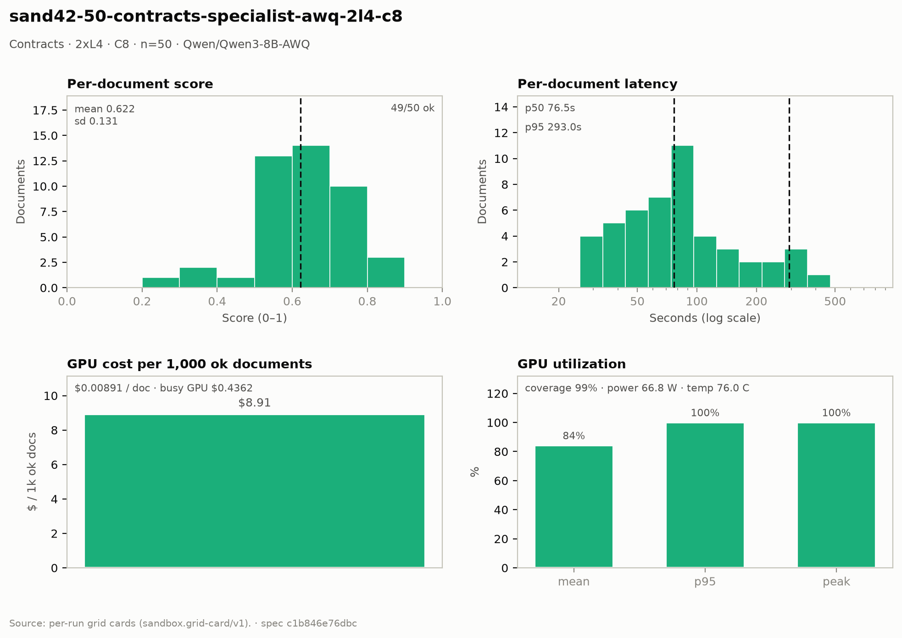

# Contracts — 2× L4 · C8 · n=50

**Run:** `sand42-50-contracts-specialist-awq-2l4-c8` · **Model:** Qwen/Qwen3-8B-AWQ · vLLM v0.29.0 · Modal `sandbox-vllm` · L4 @ $0.80/GPU-hr

## Conditions

| Condition | Value |
| --- | --- |
| Task | contracts_specialist |
| Prompt | contracts_specialist_v33_simplified |
| Temperature | 0.7 (posture knob) |
| Output cap (max_tokens) | 8,192 |
| Input cap (max_input_chars) | 49,000 |
| Chunk window (chars) | 43000 |
| Chunk overlap (chars) | 6000 |
| Job retries | 2 |
| Dataset | Lucius-Morningstar/mailroom-dataset ground_truth @ ed7576b6, split=all, seed 42 |
| Draw | 50 docs (fingerprint 83eb6b1f2c7e) |
| Engine | awq_marlin · fp8 KV · CUDA graphs [1, 2, 4, 8, 16] · prefix caching on · thinking off |
| Admission | max_model_len 32768 · max_num_seqs 16 per replica · max_inputs 32 |

## Score & cost card

| Metric | Value |
| --- | ---: |
| **Run** |  |
| Run ID | `sand42-50-contracts-specialist-awq-2l4-c8` |
| GPUs / replicas | 2 |
| Concurrency | 8 (4 per replica) |
| Documents | 50 |
| Spec hash | c1b846e7… |
| **Time** |  |
| Wall (busy) | 981.45 s |
| GPU seconds | 982.66 s |
| Cold boot | 0.35 s |
| **Cost** |  |
| Busy-window GPU $ | $0.436201 |
| Billed GPU $ | $0.436736 |
| Billed seconds | 982.66 s |
| Idle $ | $0.130794 (294.29 s) |
| Cost per document | $0.008735 |
| Cost per ok document | $0.008913 |
| Cost per 1M tokens | $0.4993 |
| **Tokens** |  |
| Prompt tokens | 755,259 |
| Completion tokens | 119,420 (13.7%) |
| Total tokens | 874,679 |
| Tokens per document | 17,851 |
| Per document: instructions + template | 3,587 (20.1%) |
| Per document: document text | 11,826 (66.3%) |
| Per document: output | 2,437 (13.7%) |
| Instruction tokens per model call | 2,093 over 84 calls |
| Token split basis | document chars ÷ 4.5 chars/token; instructions are the remainder |
| Completion p95 / max (ok docs) | 7,063 / 7,630 |
| **Throughput** |  |
| Tokens / second | 891.2 |
| Tokens / second per L4 | 445.6 |
| Documents / minute | 3.06 |
| **Latency (per document, ok rows)** |  |
| Mean | 112.19 s |
| p50 | 76.47 s |
| p95 | 292.95 s |
| Max | 802.85 s |
| **Engine (vLLM /metrics)** |  |
| Parallelism (Σ latency ÷ wall) | 5.91× of 8 |
| Slot occupancy | 73.9% |
| Coverage | replicas observed: 2 of 2 |
| Requests per replica (this run) | 42 / 43 |
| Mean TTFT per replica | 1.475 s / 1.669 s |
| Prefix-cache hit per replica | 38.4% / 36.9% |
| Preemptions per replica (this run) | 0 / 0 |
| Length-capped finishes per replica (this run) | 2 / 2 |
| **GPU hardware (nvidia-smi)** | 333 samples · serving-replica nvidia-smi |
| GPU utilization | 84.2 % mean (p95 100.0 / peak 100.0 / min 0.0) |
| Sampling coverage | 99.1 % |
| GPU power draw | 66.8 W (min 31.5 / max 73.8) of 72 W cap |
| GPU memory bandwidth | 80.0 % (min 0.0 / max 100.0) |
| GPU SM clock | 1,450 MHz (min 885 / max 2,040) |
| GPU temperature | 76.0 C (min 68.0 / max 82.0) |
| GPU memory used | 21,000 MiB (min 20,996 / max 21,002) |
| **Quality** |  |
| Overall extraction score | 0.6219 (sd 0.131) |
| Score min / max | 0.2979 / 0.8750 |
| Scoring method | `suite+cuad` |
| Schema-valid rate | 1.00 |
| Parse errors | 0 |
| Errors | 1 / 50 |
| **Clause scoring (CUAD)** |  |
| Docs with CUAD labels | 44 |
| Micro precision / recall / F1 | 0.652 / 0.582 / 0.615 |
| Metadata value checks | 74 / 124 |
| Suite field score (mean) | not captured |

## Errors

| Error | Count |
| --- | ---: |
| LengthFinishReasonError | 1 |

## Figure

## Per-document results

| # | Document | OK | Score | Latency (s) | Prompt tok | Completion tok | Error |
| ---: | --- | --- | ---: | ---: | ---: | ---: | --- |
| 1 | `DOC-a9850db362f57916` | yes | — | 28.9 | 6764 | 897 | — |
| 2 | `DOC-6b4cc54c8c4d796f` | yes | — | 29.9 | 4015 | 918 | — |
| 3 | `DOC-3c07c9ccd9a01d6e` | yes | 0.7059 | 34.1 | 7428 | 994 | — |
| 4 | `DOC-f5a54932794ef16e` | yes | 0.6667 | 49.4 | 5302 | 1146 | — |
| 5 | `DOC-b1aba7df0380a1b2` | yes | — | 78.9 | 5032 | 1945 | — |
| 6 | `DOC-fc9671ccde642e8d` | yes | — | 86.5 | 7936 | 2087 | — |
| 7 | `DOC-6671a684f52f82a9` | yes | 0.6897 | 59.3 | 11320 | 1579 | — |
| 8 | `DOC-03529267ee75444d` | yes | 0.5882 | 72.0 | 10583 | 1824 | — |
| 9 | `DOC-385a86c69f8e562c` | yes | 0.6667 | 88.5 | 6560 | 2261 | — |
| 10 | `DOC-0812d9d3e2b1baa0` | yes | 0.6154 | 81.6 | 18679 | 2091 | — |
| 11 | `DOC-593f2c6de770b84c` | yes | 0.6667 | 51.0 | 9228 | 1227 | — |
| 12 | `DOC-b87880882e5fe354` | yes | — | 163.1 | 19278 | 4037 | — |
| 13 | `DOC-0752e0811f5f5eb7` | yes | 0.3333 | 181.4 | 41619 | 4486 | — |
| 14 | `DOC-4fb6419e37bff201` | yes | 0.7692 | 118.5 | 22234 | 2931 | — |
| 15 | `DOC-e235bc9735f96335` | yes | 0.6000 | 144.1 | 10699 | 3684 | — |
| 16 | `DOC-f8b0d4bcbac60ca2` | yes | 0.6667 | 46.9 | 3824 | 1120 | — |
| 17 | `DOC-9cee2e10b449a71c` | yes | 0.6875 | 79.2 | 21752 | 2095 | — |
| 18 | `DOC-81c4ce12d907380c` | yes | 0.5714 | 97.5 | 7047 | 2632 | — |
| 19 | `DOC-812192e392d8d410` | yes | 0.5000 | 95.7 | 5551 | 2620 | — |
| 20 | `DOC-b83763aeff114369` | yes | 0.7586 | 63.9 | 7446 | 1746 | — |
| 21 | `DOC-e29140d2e8e989be` | yes | 0.6667 | 279.9 | 45485 | 7389 | — |
| 22 | `DOC-9a36838df2878b37` | yes | 0.5385 | 74.4 | 8142 | 1924 | — |
| 23 | `DOC-73055dbb1e9f5f2f` | yes | 0.5455 | 293.0 | 49409 | 7630 | — |
| 24 | `DOC-035731e655e67aab` | yes | 0.6316 | 60.4 | 5207 | 1446 | — |
| 25 | `DOC-e4272758b561f8cd` | no | — | 304.3 | — | — | LengthFinishReasonError: Could not parse response content as the length limit was reached - CompletionUsage(completion_tokens=8192, prompt_tokens=6987, total_to |
| 26 | `DOC-e998c563b82122b9` | yes | 0.5263 | 53.0 | 10006 | 1272 | — |
| 27 | `DOC-27b649fe2f6fae8e` | yes | 0.8750 | 51.0 | 5464 | 1219 | — |
| 28 | `DOC-1e22a2d4068b8650` | yes | 0.7143 | 67.1 | 7587 | 1671 | — |
| 29 | `DOC-1266801f2faad19f` | yes | 0.7083 | 167.8 | 33383 | 4156 | — |
| 30 | `DOC-70f90b46b2c4f1a6` | yes | 0.8571 | 15.1 | 3154 | 392 | — |
| 31 | `DOC-2b510409d3b9a4a6` | yes | 0.4138 | 395.8 | 9632 | 2055 | — |
| 32 | `DOC-dfb4e69a3ab10dc9` | yes | 0.7692 | 31.7 | 7378 | 801 | — |
| 33 | `DOC-1ddc9333769d27e4` | yes | 0.5000 | 41.0 | 4450 | 984 | — |
| 34 | `DOC-8993ad1085e08bd0` | yes | 0.7000 | 91.3 | 22402 | 2184 | — |
| 35 | `DOC-fe06800cc62e5e19` | yes | 0.6471 | 38.8 | 8619 | 1158 | — |
| 36 | `DOC-186145066ab191fa` | yes | 0.3333 | 27.0 | 3718 | 886 | — |
| 37 | `DOC-62b300182901e850` | yes | 0.2979 | 119.8 | 33346 | 3153 | — |
| 38 | `DOC-472f423cdf0819ef` | yes | 0.7500 | 58.2 | 4656 | 1297 | — |
| 39 | `DOC-4b57f485708ab60b` | yes | 0.6000 | 34.4 | 6639 | 1372 | — |
| 40 | `DOC-e0d31c39359cb803` | yes | 0.6316 | 44.5 | 6879 | 947 | — |
| 41 | `DOC-f45b328fd8a54c8b` | yes | 0.7619 | 63.1 | 4608 | 1340 | — |
| 42 | `DOC-712c3f92a0a56b77` | yes | 0.5714 | 267.9 | 56227 | 6330 | — |
| 43 | `DOC-c9d4c4f8ff433527` | yes | 0.7059 | 127.5 | 7730 | 2856 | — |
| 44 | `DOC-01849fa3020a5ac1` | yes | 0.5000 | 35.1 | 4173 | 1043 | — |
| 45 | `DOC-be1eccde5bae9c82` | yes | 0.5000 | 76.5 | 9330 | 2221 | — |
| 46 | `DOC-e218d39bb2f3c5ef` | yes | 0.5333 | 103.6 | 19923 | 2583 | — |
| 47 | `DOC-dfd20f94bb76b6e4` | yes | 0.5455 | 92.5 | 21000 | 2800 | — |
| 48 | `DOC-dbe52fd78e44b0ef` | yes | 0.8696 | 87.4 | 18750 | 2434 | — |
| 49 | `DOC-8f737e9fec8f24f0` | yes | 0.5455 | 246.4 | 35815 | 6494 | — |
| 50 | `DOC-53e364f030a30b5c` | yes | 0.6383 | 802.8 | 69850 | 7063 | — |

_Generated 2026-10-12T17:17:10+00:00 by `sandbox run card`. Machine-readable twin: `sand42-50-contracts-specialist-awq-2l4-c8.card.json`._
