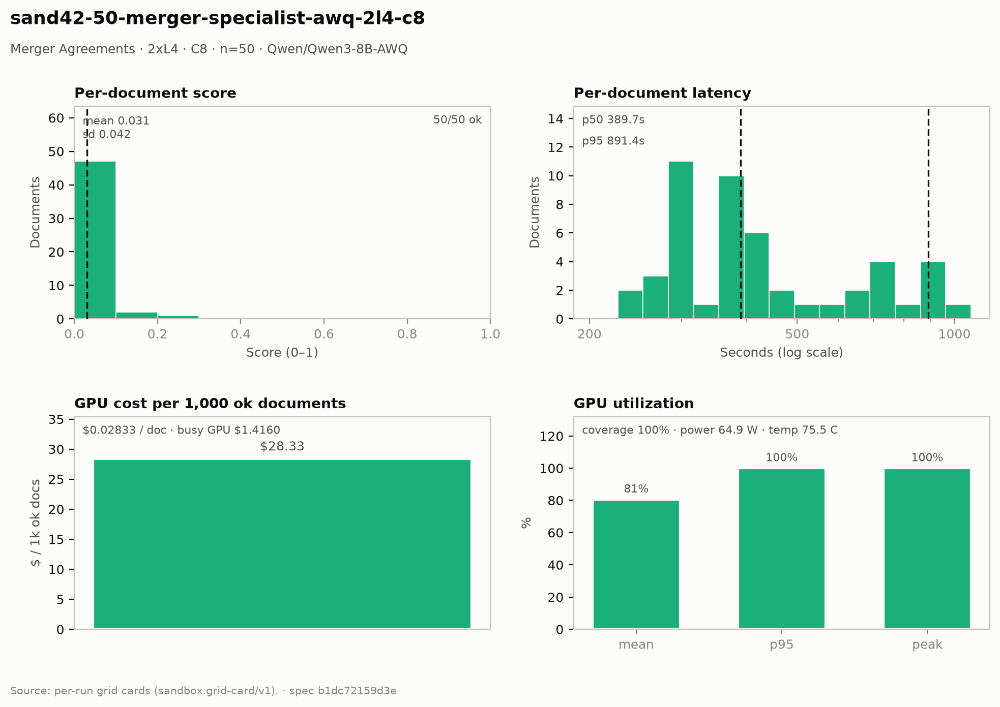

# Merger Agreements — 2× L4 · C8 · n=50

**Run:** `sand42-50-merger-specialist-awq-2l4-c8` · **Model:** Qwen/Qwen3-8B-AWQ · vLLM v0.29.0 · Modal `sandbox-vllm` · L4 @ $0.80/GPU-hr

## Conditions

| Condition | Value |
| --- | --- |
| Task | merger_agreement_specialist |
| Prompt | merger_agreement_specialist_simplified |
| Temperature | 0.7 (posture knob) |
| Output cap (max_tokens) | 6,144 |
| Input cap (max_input_chars) | 54,000 |
| top_p | 0.8 |
| top_k | 20 |
| presence_penalty | 1.0 |
| Length re-samples | 1 |
| Chunk window (chars) | 47000 |
| Chunk overlap (chars) | 6500 |
| Job retries | 2 |
| Dataset | Lucius-Morningstar/mailroom-dataset ground_truth @ ed7576b6, split=all, seed 42 |
| Draw | 50 docs (fingerprint aa4e596805e7) |
| Engine | awq_marlin · fp8 KV · CUDA graphs [1, 2, 4, 8, 16] · prefix caching on · thinking off |
| Admission | max_model_len 32768 · max_num_seqs 16 per replica · max_inputs 32 |

## Score & cost card

| Metric | Value |
| --- | ---: |
| **Run** |  |
| Run ID | `sand42-50-merger-specialist-awq-2l4-c8` |
| GPUs / replicas | 2 |
| Concurrency | 8 (4 per replica) |
| Documents | 50 |
| Spec hash | b1dc7215… |
| **Time** |  |
| Wall (busy) | 3,185.97 s |
| GPU seconds | 3,186.68 s |
| Cold boot | 0.38 s |
| **Cost** |  |
| Busy-window GPU $ | $1.415988 |
| Billed GPU $ | $1.416304 |
| Billed seconds | 3,186.68 s |
| Idle $ | $0.128444 (289.00 s) |
| Cost per document | $0.028326 |
| Cost per ok document | $0.028326 |
| Cost per 1M tokens | $0.2740 |
| **Tokens** |  |
| Prompt tokens | 4,867,606 |
| Completion tokens | 301,770 (5.8%) |
| Total tokens | 5,169,376 |
| Tokens per document | 103,388 |
| Per document: instructions + template | 6,178 (6.0%) |
| Per document: document text | 91,174 (88.2%) |
| Per document: output | 6,035 (5.8%) |
| Instruction tokens per model call | 750 over 412 calls |
| Token split basis | document chars ÷ 4.5 chars/token; instructions are the remainder |
| Completion p95 / max (ok docs) | 7,733 / 10,330 |
| **Throughput** |  |
| Tokens / second | 1,622.5 |
| Tokens / second per L4 | 811.3 |
| Documents / minute | 0.94 |
| **Latency (per document, ok rows)** |  |
| Mean | 463.52 s |
| p50 | 389.66 s |
| p95 | 891.42 s |
| Max | 1,075.39 s |
| **Engine (vLLM /metrics)** |  |
| Parallelism (Σ latency ÷ wall) | 7.27× of 8 |
| Slot occupancy | 90.9% |
| Coverage | replicas observed: 2 of 2 |
| Requests per replica (this run) | 211 / 215 |
| Mean TTFT per replica | 3.230 s / 3.267 s |
| Prefix-cache hit per replica | 18.4% / 17.4% |
| Preemptions per replica (this run) | 0 / 0 |
| Length-capped finishes per replica (this run) | 4 / 4 |
| **GPU hardware (nvidia-smi)** | 1071 samples · serving-replica nvidia-smi |
| GPU utilization | 80.6 % mean (p95 100.0 / peak 100.0 / min 0.0) |
| Sampling coverage | 99.7 % |
| GPU power draw | 64.9 W (min 29.9 / max 74.9) of 72 W cap |
| GPU memory bandwidth | 68.5 % (min 0.0 / max 100.0) |
| GPU SM clock | 1,439 MHz (min 870 / max 2,040) |
| GPU temperature | 75.5 C (min 58.0 / max 82.0) |
| GPU memory used | 21,002 MiB (min 21,000 / max 21,002) |
| **Quality** |  |
| Overall extraction score | 0.0310 (sd 0.042) |
| Score min / max | 0.0000 / 0.2000 |
| Scoring method | `suite+maud` |
| Schema-valid rate | 1.00 |
| Parse errors | 0 |
| Errors | 0 / 50 |
| **Clause scoring (MAUD)** |  |
| Questions answered / labeled | 283 / 811 (34.9%) |
| Micro accuracy | 3.1% |
| Precision on answered | 8.8% |
| Clean subset | 19 / 343 |
| Suite field score (mean) | not captured |

## Figure

## Per-document results

| # | Document | OK | Score | Latency (s) | Prompt tok | Completion tok | Error |
| ---: | --- | --- | ---: | ---: | ---: | ---: | --- |
| 1 | `DOC-0a733ab86f2390ae` | yes | 0.0667 | 266.8 | 81545 | 3938 | — |
| 2 | `DOC-eb2b56fe30dc35f4` | yes | 0.0000 | 284.3 | 85298 | 4465 | — |
| 3 | `DOC-5f5d40f6b2c338ac` | yes | 0.0000 | 296.0 | 109887 | 4588 | — |
| 4 | `DOC-26933c93d649fa3f` | yes | 0.0625 | 305.7 | 96354 | 5774 | — |
| 5 | `DOC-c96b9c7e12f91576` | yes | 0.0000 | 363.4 | 92490 | 5861 | — |
| 6 | `DOC-d4b1a7a2b981fbf4` | yes | 0.0588 | 399.5 | 81817 | 6085 | — |
| 7 | `DOC-4f45bef14dcd1dbf` | yes | 0.0625 | 234.2 | 70774 | 4363 | — |
| 8 | `DOC-52f9a5be69429299` | yes | 0.0000 | 308.0 | 103918 | 5639 | — |
| 9 | `DOC-dc7f18df501aec90` | yes | 0.0000 | 605.9 | 83008 | 4020 | — |
| 10 | `DOC-b03c0d2bbbb9659e` | yes | 0.0000 | 304.9 | 113393 | 5267 | — |
| 11 | `DOC-9420b777a4b0784c` | yes | 0.0000 | 389.4 | 98627 | 6655 | — |
| 12 | `DOC-45f801408be08af6` | yes | 0.0000 | 737.6 | 109920 | 6894 | — |
| 13 | `DOC-e8538f75b0f993e6` | yes | 0.0000 | 389.9 | 113280 | 7349 | — |
| 14 | `DOC-882fabf7aba36941` | yes | 0.0000 | 292.9 | 92325 | 5217 | — |
| 15 | `DOC-30eda1e78a5f6fb5` | yes | 0.0000 | 366.4 | 107499 | 6381 | — |
| 16 | `DOC-bec74557186e9409` | yes | 0.0000 | 202.8 | 78918 | 5162 | — |
| 17 | `DOC-5f8ef95caa2fd349` | yes | 0.0000 | 390.8 | 104105 | 6823 | — |
| 18 | `DOC-ab5578f1f9f04244` | yes | 0.2000 | 445.2 | 132059 | 7311 | — |
| 19 | `DOC-71bc59dd305ee8ed` | yes | 0.0769 | 729.3 | 109675 | 6371 | — |
| 20 | `DOC-f90cc5fb2ceac154` | yes | 0.0000 | 377.4 | 93747 | 6526 | — |
| 21 | `DOC-63beb09b179ea4ee` | yes | 0.0588 | 283.9 | 83572 | 5020 | — |
| 22 | `DOC-511062d64bc9afc6` | yes | 0.0000 | 707.4 | 97584 | 5749 | — |
| 23 | `DOC-0534799ed39ca0db` | yes | 0.0000 | 305.1 | 92828 | 5537 | — |
| 24 | `DOC-37bc3c44ae2c4ef6` | yes | 0.0000 | 388.9 | 90012 | 6881 | — |
| 25 | `DOC-fe9a8b51344d67d9` | yes | 0.0000 | 441.0 | 130099 | 7733 | — |
| 26 | `DOC-1e016055aa435e71` | yes | 0.0000 | 679.9 | 109137 | 5805 | — |
| 27 | `DOC-c6b5f7ea5f718c28` | yes | 0.1176 | 252.9 | 82765 | 3937 | — |
| 28 | `DOC-2b9f668ab6cb8901` | yes | 0.0526 | 402.7 | 90831 | 7581 | — |
| 29 | `DOC-297745a521cd1e8c` | yes | 0.0000 | 531.9 | 103150 | 9294 | — |
| 30 | `DOC-72b0b8c8385edd48` | yes | 0.0556 | 295.0 | 84431 | 4419 | — |
| 31 | `DOC-386ac6d669b7731c` | yes | 0.0769 | 388.3 | 93831 | 6697 | — |
| 32 | `DOC-26fa94f698c37fc5` | yes | 0.0588 | 314.1 | 79931 | 5418 | — |
| 33 | `DOC-f9870e3b8fd141b0` | yes | 0.0000 | 396.6 | 134889 | 7636 | — |
| 34 | `DOC-ac48214468deb8dd` | yes | 0.0588 | 266.1 | 72887 | 4961 | — |
| 35 | `DOC-7e2818ceb0167d5a` | yes | 0.1111 | 486.9 | 78432 | 4425 | — |
| 36 | `DOC-0070a4e34dddbfd5` | yes | 0.0000 | 382.0 | 85209 | 7153 | — |
| 37 | `DOC-e6c8852b877c4598` | yes | 0.0000 | 394.3 | 104093 | 6952 | — |
| 38 | `DOC-fcaddb5bdc94ce63` | yes | 0.0588 | 654.0 | 82656 | 5177 | — |
| 39 | `DOC-b3d0149fd994357a` | yes | 0.0588 | 256.8 | 78500 | 4896 | — |
| 40 | `DOC-9d34581755c603a3` | yes | 0.0000 | 405.9 | 94942 | 7255 | — |
| 41 | `DOC-03712a2b0a99a314` | yes | 0.0000 | 729.8 | 119367 | 6876 | — |
| 42 | `DOC-1cd38a83b224335d` | yes | 0.0588 | 326.1 | 78294 | 5167 | — |
| 43 | `DOC-169bbcdc5d9e609c` | yes | 0.0769 | 417.7 | 134911 | 7417 | — |
| 44 | `DOC-ab735131c00271bc` | yes | 0.0556 | 295.1 | 81228 | 5234 | — |
| 45 | `DOC-f09307ad314d386f` | yes | 0.0588 | 863.8 | 103329 | 5748 | — |
| 46 | `DOC-f449b47c7269f288` | yes | 0.0000 | 891.4 | 95394 | 6237 | — |
| 47 | `DOC-ff3ceb691481f1bd` | yes | 0.0000 | 855.8 | 91432 | 4853 | — |
| 48 | `DOC-681bc6115b882191` | yes | 0.0000 | 926.8 | 120554 | 6667 | — |
| 49 | `DOC-23f224263f6974c5` | yes | 0.0000 | 869.8 | 83736 | 6026 | — |
| 50 | `DOC-5d30efc302f3c431` | yes | 0.0625 | 1,075.4 | 130943 | 10330 | — |

_Generated 2026-10-12T17:17:14+00:00 by `sandbox run card`. Machine-readable twin: `sand42-50-merger-specialist-awq-2l4-c8.card.json`._
