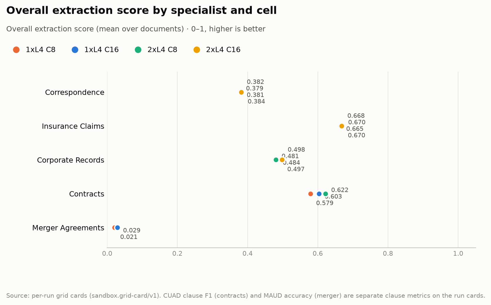
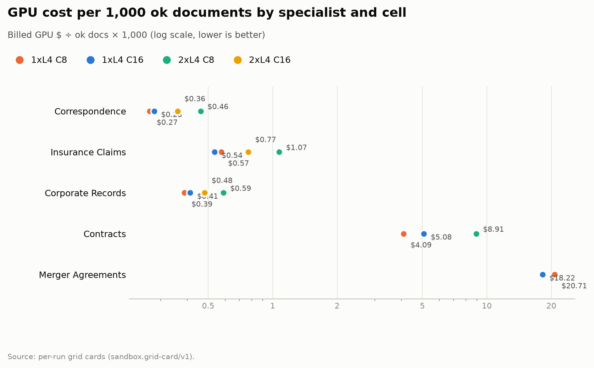
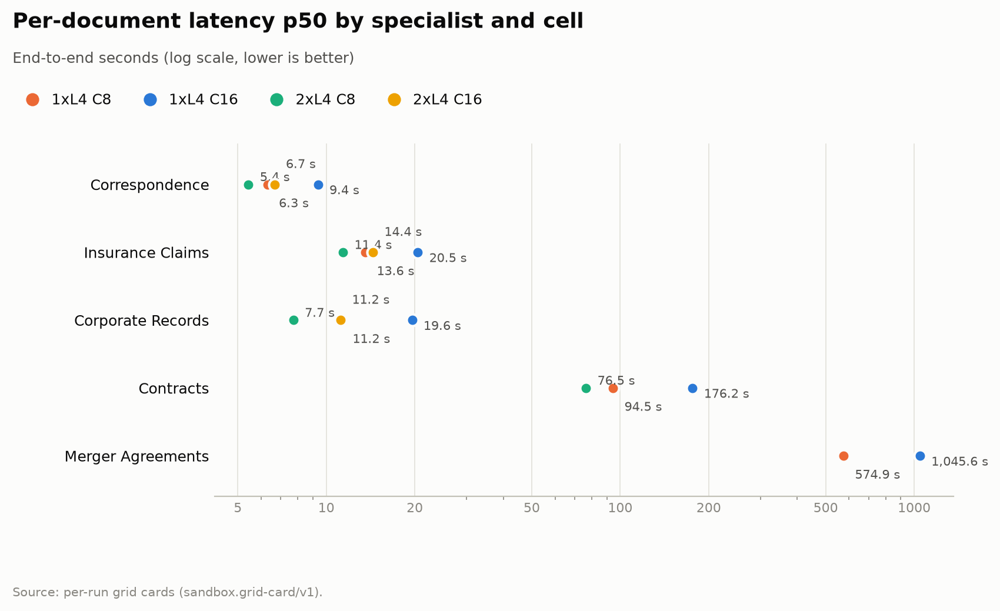
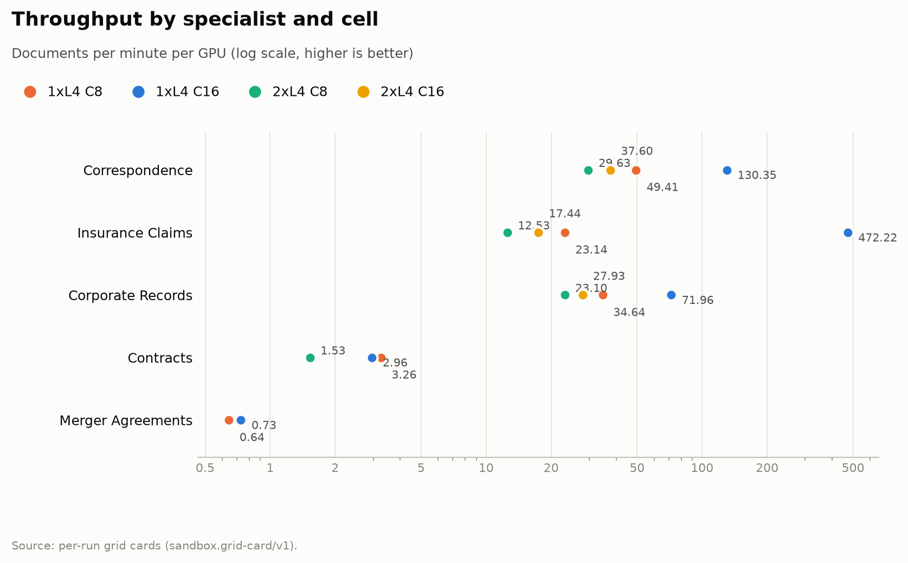
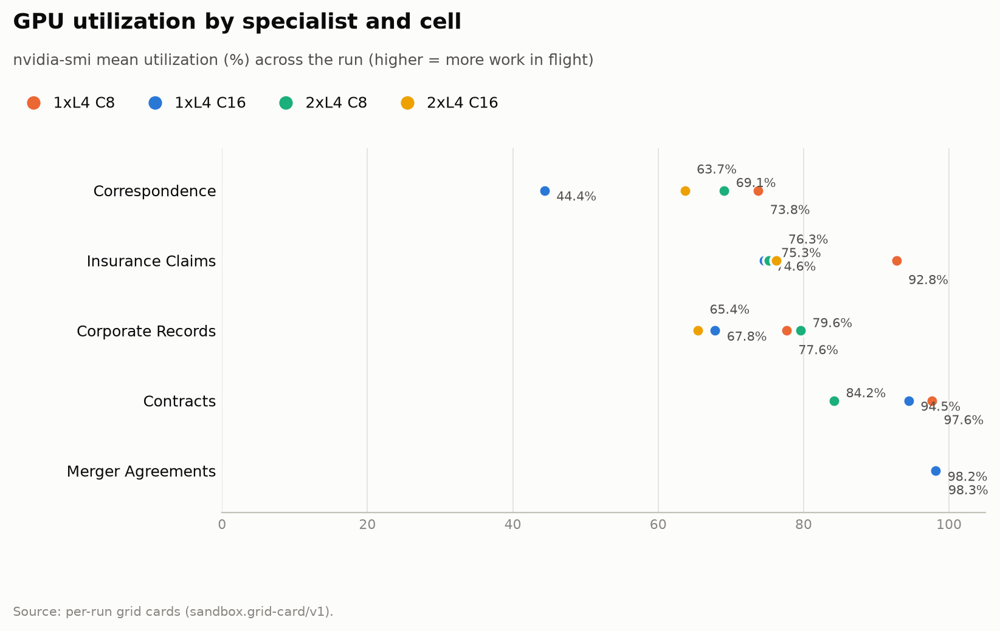

# SAND-042 master report — full detail

Per-condition tables, engine and GPU telemetry, the paired comparison and the method. Executive summary: [`SAND42-MASTER-SCORE-COST-CARD.md`](SAND42-MASTER-SCORE-COST-CARD.md).

# SAND-042 · 1× L4 · client concurrency 8 · n=50 × 5 specialists

**Cells reported:** 5 of 5 · **Runbook:** `sand42-1l4-c8` · **Model:** Qwen/Qwen3-8B-AWQ · L4 @ $0.80/GPU-hr

## Shared conditions

| Condition | Value |
| --- | --- |
| Engine | — · max_model_len 32768 · max_num_seqs 16/replica · max_inputs 32 |
| Fleet | 1 replica(s) · client concurrency 8 (8 per replica) |
| Dataset | `Lucius-Morningstar/mailroom-dataset` ground_truth @ ed7576b6, split=all, seed 42, one class bucket, 50 per class stratified over every subclass (min 1 per sub-type) |
| Prompt | v1 `*_simplified` stems only |
| Output cap | max_tokens 8,192 · temperature 0.7 contracts + merger, 0.1 elsewhere |
| GPU telemetry | in-container nvidia-smi series, label `sand42-1l4-c8` |

## Per specialist

| Metric | Correspondence | Insurance Claims | Corporate Records | Contracts | Merger Agreements |
| --- | ---: | ---: | ---: | ---: | ---: |
| Quality (95% CI) | 0.384 [0.316, 0.451] | 0.670 [0.653, 0.685] | 0.497 [0.427, 0.569] | 0.579 [0.543, 0.614] | 0.021 [0.012, 0.030] |
| Scored documents | 50 | 50 | 50 | 45 | 50 |
| Quality SD | 0.246 | 0.060 | 0.254 | 0.123 | 0.032 |
| Scoring method | suite | suite | suite | suite+cuad | suite+maud |
| Clause metric | — | — | — | CUAD F1 0.585 · 45 labeled | MAUD acc 2.1% · 254/811 answered |
| Ok rate (Wilson) | 50/50 100.0% [0.929, 1.000] | 50/50 100.0% [0.929, 1.000] | 50/50 100.0% [0.929, 1.000] | 50/50 100.0% [0.929, 1.000] | 50/50 100.0% [0.929, 1.000] |
| Schema-valid rate | 100.0% | 30.0% | 96.0% | 100.0% | 100.0% |
| Parse errors | 0 | 0 | 0 | 0 | 0 |
| Length-capped | 0 | 0 | 0 | 0 | 0 |
| Error kinds | — | — | — | — | — |
| p50 latency (s) | 6.3 | 13.6 | 11.2 | 94.5 | 574.9 |
| p95 latency (s) | 8.9 | 24.6 | 13.6 | 316.4 | 1,324.9 |
| SLO (s) · met | 60 · yes | 60 · yes | 60 · yes | 300 · no | 1,800 · yes |
| Documents/min | 49.41 | 23.14 | 34.64 | 3.26 | 0.64 |
| Documents/min/GPU | 49.41 | 23.14 | 34.64 | 3.26 | 0.64 |
| Goodput docs/min/GPU | 49.41 | 23.14 | 34.64 | 0.00 | 0.64 |
| Tokens/s/GPU | 2,258.4 | 1,438.9 | 2,371.5 | 1,009.7 | 1,113.2 |
| Mean TTFT (s) | 0.72 | 0.90 | 1.21 | 1.95 | 4.01 |
| Prefix-cache hit | 63.6% | 58.4% | 50.9% | 38.3% | 18.4% |
| Wall (s) | 60.7 | 129.7 | 86.6 | 920.0 | 4,657.5 |
| Billed GPU $ (run) | $0.0133 | $0.0287 | $0.0194 | $0.2046 | $1.0356 |
| $ / 1k ok docs | $0.266880 | $0.574880 | $0.387920 | $4.091500 | $20.712260 |
| $ / 1k schema-valid | $0.266880 | $1.916267 | $0.404083 | $4.091500 | $20.712260 |
| $ / doc | $0.000267 | $0.000575 | $0.000388 | $0.004092 | $0.020712 |
| $ / ok doc | $0.000267 | $0.000575 | $0.000388 | $0.004092 | $0.020712 |
| $ / 1M tokens | $0.097 | $0.154 | $0.094 | $0.220 | $0.200 |
| GPU util (mean/p95/min–max) | 73.8% mean / 99.0 p95 / 0.0–99.0% min–max (n=8) | 92.8% mean / 99.0 p95 / 0.0–99.0% min–max (n=18) | 77.6% mean / 100.0 p95 / 0.0–100.0% min–max (n=14) | 97.6% mean / 100.0 p95 / 0.0–100.0% min–max (n=139) | 98.3% mean / 100.0 p95 / 0.0–100.0% min–max (n=699) |
| GPU mem used (mean) | 20,994 MiB (91.1% of 23,034) | 21,023 MiB (91.3% of 23,034) | 21,023 MiB (91.3% of 23,034) | 21,026 MiB (91.3% of 23,034) | 21,027 MiB (91.3% of 23,034) |
| GPU mem bandwidth (mean) | not captured | not captured | not captured | not captured | not captured |
| Sampling coverage | 96.6% | 94.8% | 100.0% | 100.0% | 100.0% |
| GPU power (W, mean) | 63.3 | 69.4 | 63.4 | 71.4 | 71.7 |
| GPU temp (C, mean) | 51.6 | 60.3 | 64.4 | 73.0 | 75.6 |
| KV cache use (max %) | 0.0 | 0.0 | 0.0 | 0.0 | 0.0 |
| Preemptions | 0 | 0 | 0 | 0 | 0 |
| Length finishes | 0 | 0 | 0 | 0 | 9 |

## Cost (computed from the session)

The fleet is pinned warm (`min_containers=1`) from deploy to teardown, so Modal meters the **whole window** — the cold boot and the idle between specialists included. This is computed from the session's own timestamps, not scraped from the billing CLI (whose figures are credits-based and workspace-wide).

| Fleet cost | Value |
| --- | ---: |
| Replicas × GPU | 1 × L4 @ $0.80/GPU-hr |
| Cold boot (deploy → ready) | not captured |
| Fleet window (deploy → teardown) | 6,080.3 s |
| Fleet GPU-hours | 1.6890 |
| **Fleet GPU $** | **$1.3512** |
| Of which the five runs | 5,857.5 s (96.3%) |
| Boot + idle overhead | 222.8 s |

## Per-run cards

| Specialist | Run ID | Card |
| --- | --- | --- |
| Correspondence | `sand42-50-correspondence-specialist-awq-1l4-c8` | [sand42-50-correspondence-specialist-awq-1l4-c8.card.md](1L4-c8/correspondence/sand42-50-correspondence-specialist-awq-1l4-c8.card.md) |
| Insurance Claims | `sand42-50-insurance-claims-specialist-awq-1l4-c8` | [sand42-50-insurance-claims-specialist-awq-1l4-c8.card.md](1L4-c8/insurance_claims/sand42-50-insurance-claims-specialist-awq-1l4-c8.card.md) |
| Corporate Records | `sand42-50-corporate-records-specialist-awq-1l4-c8` | [sand42-50-corporate-records-specialist-awq-1l4-c8.card.md](1L4-c8/corporate_records/sand42-50-corporate-records-specialist-awq-1l4-c8.card.md) |
| Contracts | `sand42-50-contracts-specialist-awq-1l4-c8` | [sand42-50-contracts-specialist-awq-1l4-c8.card.md](1L4-c8/contracts/sand42-50-contracts-specialist-awq-1l4-c8.card.md) |
| Merger Agreements | `sand42-50-merger-specialist-awq-1l4-c8` | [sand42-50-merger-specialist-awq-1l4-c8.card.md](1L4-c8/merger_agreement/sand42-50-merger-specialist-awq-1l4-c8.card.md) |

_Merger dominates pooled throughput (≈ 112k prompt tokens per agreement on the frozen settings), so no pooled column is reported here — compare per class._

_Generated 2026-10-12T07:01:19+00:00 by `sandbox run card --runbook sand42-1l4-c8` from the committed per-run `*.card.json`._

---

# SAND-042 · 1× L4 · client concurrency 16 · n=50 × 5 specialists

**Cells reported:** 5 of 5 · **Runbook:** `sand42-1l4-c16` · **Model:** Qwen/Qwen3-8B-AWQ · L4 @ $0.80/GPU-hr

## Shared conditions

| Condition | Value |
| --- | --- |
| Engine | — · max_model_len 32768 · max_num_seqs 16/replica · max_inputs 32 |
| Fleet | 1 replica(s) · client concurrency 16 (16 per replica) |
| Dataset | `Lucius-Morningstar/mailroom-dataset` ground_truth @ ed7576b6, split=all, seed 42, one class bucket, 50 per class stratified over every subclass (min 1 per sub-type) |
| Prompt | v1 `*_simplified` stems only |
| Output cap | max_tokens 8,192 · temperature 0.7 contracts + merger, 0.1 elsewhere |
| GPU telemetry | in-container nvidia-smi series, label `sand42-1l4-c16` |

## Per specialist

| Metric | Correspondence | Insurance Claims | Corporate Records | Contracts | Merger Agreements |
| --- | ---: | ---: | ---: | ---: | ---: |
| Quality (95% CI) | 0.381 [0.313, 0.447] | 0.665 [0.647, 0.683] | 0.484 [0.413, 0.553] | 0.603 [0.565, 0.642] | 0.029 [0.019, 0.039] |
| Scored documents | 50 | 50 | 50 | 45 | 50 |
| Quality SD | 0.244 | 0.063 | 0.251 | 0.130 | 0.036 |
| Scoring method | suite | suite | suite | suite+cuad | suite+maud |
| Clause metric | — | — | — | CUAD F1 0.613 · 45 labeled | MAUD acc 2.8% · 247/811 answered |
| Ok rate (Wilson) | 50/50 100.0% [0.929, 1.000] | 50/50 100.0% [0.929, 1.000] | 50/50 100.0% [0.929, 1.000] | 50/50 100.0% [0.929, 1.000] | 50/50 100.0% [0.929, 1.000] |
| Schema-valid rate | 100.0% | 28.0% | 96.0% | 100.0% | 100.0% |
| Parse errors | 0 | 0 | 0 | 0 | 0 |
| Length-capped | 0 | 0 | 0 | 0 | 0 |
| Error kinds | — | — | — | — | — |
| p50 latency (s) | 9.4 | 20.5 | 19.6 | 176.2 | 1,045.6 |
| p95 latency (s) | 14.0 | 30.3 | 24.3 | 914.4 | 1,891.2 |
| SLO (s) · met | 60 · yes | 60 · yes | 60 · yes | 300 · no | 1,800 · no |
| Documents/min | 130.35 | 472.22 | 71.96 | 2.96 | 0.73 |
| Documents/min/GPU | 130.35 | 472.22 | 71.96 | 2.96 | 0.73 |
| Goodput docs/min/GPU | 130.35 | 472.22 | 71.96 | 0.00 | 0.00 |
| Tokens/s/GPU | 5,966.5 | 29,287.6 | 4,924.8 | 920.8 | 1,262.0 |
| Mean TTFT (s) | 1.42 | 1.80 | 2.56 | 14.35 | 6.71 |
| Prefix-cache hit | 63.6% | 58.4% | 50.9% | 28.1% | 14.0% |
| Wall (s) | 23.0 | 6.4 | 41.7 | 1,012.0 | 4,098.5 |
| Billed GPU $ (run) | $0.0140 | $0.0268 | $0.0206 | $0.2541 | $0.9110 |
| $ / 1k ok docs | $0.279800 | $0.536440 | $0.412340 | $5.082960 | $18.219480 |
| $ / 1k schema-valid | $0.279800 | $1.915857 | $0.429521 | $5.082960 | $18.219480 |
| $ / doc | $0.000280 | $0.000536 | $0.000412 | $0.005083 | $0.018219 |
| $ / ok doc | $0.000280 | $0.000536 | $0.000412 | $0.005083 | $0.018219 |
| $ / 1M tokens | $0.102 | $0.144 | $0.100 | $0.273 | $0.176 |
| GPU util (mean/p95/min–max) | 44.4% mean / 100.0 p95 / 0.0–100.0% min–max (n=11) | 74.6% mean / 100.0 p95 / 0.0–100.0% min–max (n=21) | 67.8% mean / 100.0 p95 / 0.0–100.0% min–max (n=16) | 94.5% mean / 100.0 p95 / 0.0–100.0% min–max (n=167) | 98.2% mean / 100.0 p95 / 0.0–100.0% min–max (n=651) |
| GPU mem used (mean) | 21,002 MiB (91.2% of 23,034) | 21,025 MiB (91.3% of 23,034) | 21,026 MiB (91.3% of 23,034) | 21,024 MiB (91.3% of 23,034) | 21,027 MiB (91.3% of 23,034) |
| GPU mem bandwidth (mean) | 38.9% mean | 66.9% mean | 47.2% mean | 84.7% mean | 78.2% mean |
| Sampling coverage | 100.0% | 100.0% | 100.0% | 88.4% ⚠ below the 90% gate (issue #128) | 100.0% |
| GPU power (W, mean) | 51.0 | 61.7 | 59.2 | 70.5 | 71.7 |
| GPU temp (C, mean) | 73.6 | 75.2 | 75.1 | 75.8 | 76.5 |
| KV cache use (max %) | 0.0 | 0.0 | 0.0 | 0.0 | 0.0 |
| Preemptions | 0 | 0 | 0 | 0 | 0 |
| Length finishes | 0 | 0 | 0 | 0 | 10 |

## Cost (computed from the session)

The fleet is pinned warm (`min_containers=1`) from deploy to teardown, so Modal meters the **whole window** — the cold boot and the idle between specialists included. This is computed from the session's own timestamps, not scraped from the billing CLI (whose figures are credits-based and workspace-wide).

| Fleet cost | Value |
| --- | ---: |
| Replicas × GPU | 1 × L4 @ $0.80/GPU-hr |
| Cold boot (deploy → ready) | not captured |
| Fleet window (deploy → teardown) | 5,690.0 s |
| Fleet GPU-hours | 1.5806 |
| **Fleet GPU $** | **$1.2644** |
| Of which the five runs | 5,519.5 s (97.0%) |
| Boot + idle overhead | 170.5 s |

## Per-run cards

| Specialist | Run ID | Card |
| --- | --- | --- |
| Correspondence | `sand42-50-correspondence-specialist-awq-1l4-c16` | [sand42-50-correspondence-specialist-awq-1l4-c16.card.md](1L4-c16/correspondence/sand42-50-correspondence-specialist-awq-1l4-c16.card.md) |
| Insurance Claims | `sand42-50-insurance-claims-specialist-awq-1l4-c16` | [sand42-50-insurance-claims-specialist-awq-1l4-c16.card.md](1L4-c16/insurance_claims/sand42-50-insurance-claims-specialist-awq-1l4-c16.card.md) |
| Corporate Records | `sand42-50-corporate-records-specialist-awq-1l4-c16` | [sand42-50-corporate-records-specialist-awq-1l4-c16.card.md](1L4-c16/corporate_records/sand42-50-corporate-records-specialist-awq-1l4-c16.card.md) |
| Contracts | `sand42-50-contracts-specialist-awq-1l4-c16` | [sand42-50-contracts-specialist-awq-1l4-c16.card.md](1L4-c16/contracts/sand42-50-contracts-specialist-awq-1l4-c16.card.md) |
| Merger Agreements | `sand42-50-merger-specialist-awq-1l4-c16` | [sand42-50-merger-specialist-awq-1l4-c16.card.md](1L4-c16/merger_agreement/sand42-50-merger-specialist-awq-1l4-c16.card.md) |

_Merger dominates pooled throughput (≈ 112k prompt tokens per agreement on the frozen settings), so no pooled column is reported here — compare per class._

_Generated 2026-10-12T07:01:19+00:00 by `sandbox run card --runbook sand42-1l4-c16` from the committed per-run `*.card.json`._

---

# SAND-042 · 2× L4 · client concurrency 8 (4 per replica) · n=50 × 5 specialists

**Cells reported:** 4 of 5 · **Runbook:** `sand42-2l4-c8` · **Model:** Qwen/Qwen3-8B-AWQ · L4 @ $0.80/GPU-hr

## Shared conditions

| Condition | Value |
| --- | --- |
| Engine | — · max_model_len 32768 · max_num_seqs 16/replica · max_inputs 32 |
| Fleet | 2 replica(s) · client concurrency 8 (4 per replica) |
| Dataset | `Lucius-Morningstar/mailroom-dataset` ground_truth @ ed7576b6, split=all, seed 42, one class bucket, 50 per class stratified over every subclass (min 1 per sub-type) |
| Prompt | v1 `*_simplified` stems only |
| Output cap | max_tokens 8,192 · temperature 0.7 contracts + merger, 0.1 elsewhere |
| GPU telemetry | in-container nvidia-smi series, label `sand42-2l4-c8` |

## Per specialist

| Metric | Correspondence | Insurance Claims | Corporate Records | Contracts | Merger Agreements |
| --- | ---: | ---: | ---: | ---: | ---: |
| Quality (95% CI) | 0.379 [0.310, 0.447] | 0.670 [0.653, 0.687] | 0.481 [0.412, 0.550] | 0.622 [0.581, 0.659] | not run |
| Scored documents | 50 | 50 | 50 | 44 | not run |
| Quality SD | 0.241 | 0.064 | 0.249 | 0.131 | not run |
| Scoring method | suite | suite | suite | suite+cuad | not run |
| Clause metric | — | — | — | CUAD F1 0.615 · 44 labeled | not run |
| Ok rate (Wilson) | 50/50 100.0% [0.929, 1.000] | 50/50 100.0% [0.929, 1.000] | 50/50 100.0% [0.929, 1.000] | 49/50 98.0% [0.895, 0.996] | not run |
| Schema-valid rate | 100.0% | 30.0% | 96.0% | 100.0% | not run |
| Parse errors | 0 | 0 | 0 | 0 | not run |
| Length-capped | 0 | 0 | 0 | 1 | not run |
| Error kinds | — | — | — | LengthFinishReasonError×1 | not run |
| p50 latency (s) | 5.4 | 11.4 | 7.7 | 76.5 | not run |
| p95 latency (s) | 8.1 | 18.6 | 11.5 | 293.0 | not run |
| SLO (s) · met | 60 · yes | 60 · yes | 60 · yes | 300 · yes | not run |
| Documents/min | 59.25 | 25.06 | 46.21 | 3.06 | not run |
| Documents/min/GPU | 59.25 | 25.06 | 46.21 | 3.06 | not run |
| Goodput docs/min/GPU | 29.63 | 12.53 | 23.10 | 1.53 | not run |
| Tokens/s/GPU | 1,356.4 | 777.6 | 1,581.2 | 445.6 | not run |
| Mean TTFT (s) | 0.60 | 0.68 | 0.86 | 1.57 | not run |
| Prefix-cache hit | 62.2% | 57.2% | 49.9% | 37.7% | not run |
| Wall (s) | 50.6 | 119.7 | 64.9 | 981.5 | not run |
| Billed GPU $ (run) | $0.0231 | $0.0536 | $0.0294 | $0.4367 | not run |
| $ / 1k ok docs | $0.461040 | $1.072720 | $0.588180 | $8.912980 | not run |
| $ / 1k schema-valid | $0.461040 | $3.575733 | $0.612688 | $8.734720 | not run |
| $ / doc | $0.000461 | $0.001073 | $0.000588 | $0.008735 | not run |
| $ / ok doc | $0.000461 | $0.001073 | $0.000588 | $0.008913 | not run |
| $ / 1M tokens | $0.168 | $0.288 | $0.143 | $0.499 | not run |
| GPU util (mean/p95/min–max) | 69.1% mean / 100.0 p95 / 0.0–100.0% min–max (n=17) | 75.3% mean / 100.0 p95 / 0.0–100.0% min–max (n=40) | 79.6% mean / 100.0 p95 / 0.0–100.0% min–max (n=21) | 84.2% mean / 100.0 p95 / 0.0–100.0% min–max (n=333) | not run |
| GPU mem used (mean) | 20,983 MiB (91.1% of 23,034) | 20,997 MiB (91.2% of 23,034) | 20,997 MiB (91.2% of 23,034) | 21,000 MiB (91.2% of 23,034) | not run |
| GPU mem bandwidth (mean) | 56.4% mean | 73.0% mean | 64.5% mean | 80.0% mean | not run |
| Sampling coverage | 100.0% | 100.0% | 100.0% | 99.1% | not run |
| GPU power (W, mean) | 61.7 | 63.0 | 62.8 | 66.8 | not run |
| GPU temp (C, mean) | 71.6 | 75.8 | 77.0 | 76.0 | not run |
| KV cache use (max %) | 0.0 | 0.0 | 0.0 | 0.0 | not run |
| Preemptions | 0 | 0 | 0 | 0 | not run |
| Length finishes | 0 | 0 | 0 | 4 | not run |

## Cost (computed from the session)

Fleet window not recorded (no fleet_window.json for this cell). Per-run costs still come from each run's own container-telemetry window.

## Per-run cards

| Specialist | Run ID | Card |
| --- | --- | --- |
| Correspondence | `sand42-50-correspondence-specialist-awq-2l4-c8` | [sand42-50-correspondence-specialist-awq-2l4-c8.card.md](2L4-c8/correspondence/sand42-50-correspondence-specialist-awq-2l4-c8.card.md) |
| Insurance Claims | `sand42-50-insurance-claims-specialist-awq-2l4-c8` | [sand42-50-insurance-claims-specialist-awq-2l4-c8.card.md](2L4-c8/insurance_claims/sand42-50-insurance-claims-specialist-awq-2l4-c8.card.md) |
| Corporate Records | `sand42-50-corporate-records-specialist-awq-2l4-c8` | [sand42-50-corporate-records-specialist-awq-2l4-c8.card.md](2L4-c8/corporate_records/sand42-50-corporate-records-specialist-awq-2l4-c8.card.md) |
| Contracts | `sand42-50-contracts-specialist-awq-2l4-c8` | [sand42-50-contracts-specialist-awq-2l4-c8.card.md](2L4-c8/contracts/sand42-50-contracts-specialist-awq-2l4-c8.card.md) |
| Merger Agreements | `sand42-50-merger-specialist-awq-2l4-c8` | not run |

_Merger dominates pooled throughput (≈ 112k prompt tokens per agreement on the frozen settings), so no pooled column is reported here — compare per class._

_Generated 2026-10-12T07:01:19+00:00 by `sandbox run card --runbook sand42-2l4-c8` from the committed per-run `*.card.json`._

---

# SAND-042 · 2× L4 · client concurrency 16 (8 per replica) · n=50 × 5 specialists

**Cells reported:** 3 of 5 · **Runbook:** `sand42-2l4-c16` · **Model:** Qwen/Qwen3-8B-AWQ · L4 @ $0.80/GPU-hr

## Shared conditions

| Condition | Value |
| --- | --- |
| Engine | — · max_model_len 32768 · max_num_seqs 16/replica · max_inputs 32 |
| Fleet | 2 replica(s) · client concurrency 16 (8 per replica) |
| Dataset | `Lucius-Morningstar/mailroom-dataset` ground_truth @ ed7576b6, split=all, seed 42, one class bucket, 50 per class stratified over every subclass (min 1 per sub-type) |
| Prompt | v1 `*_simplified` stems only |
| Output cap | max_tokens 8,192 · temperature 0.7 contracts + merger, 0.1 elsewhere |
| GPU telemetry | in-container nvidia-smi series, label `sand42-2l4-c16` |

## Per specialist

| Metric | Correspondence | Insurance Claims | Corporate Records | Contracts | Merger Agreements |
| --- | ---: | ---: | ---: | ---: | ---: |
| Quality (95% CI) | 0.382 [0.318, 0.447] | 0.668 [0.650, 0.686] | 0.498 [0.430, 0.565] | not run | not run |
| Scored documents | 50 | 50 | 50 | not run | not run |
| Quality SD | 0.237 | 0.063 | 0.247 | not run | not run |
| Scoring method | suite | suite | suite | not run | not run |
| Clause metric | — | — | — | not run | not run |
| Ok rate (Wilson) | 50/50 100.0% [0.929, 1.000] | 50/50 100.0% [0.929, 1.000] | 50/50 100.0% [0.929, 1.000] | not run | not run |
| Schema-valid rate | 100.0% | 24.0% | 98.0% | not run | not run |
| Parse errors | 0 | 0 | 0 | not run | not run |
| Length-capped | 0 | 0 | 0 | not run | not run |
| Error kinds | — | — | — | not run | not run |
| p50 latency (s) | 6.7 | 14.4 | 11.2 | not run | not run |
| p95 latency (s) | 10.8 | 22.5 | 19.1 | not run | not run |
| SLO (s) · met | 60 · yes | 60 · yes | 60 · yes | not run | not run |
| Documents/min | 75.20 | 34.89 | 55.86 | not run | not run |
| Documents/min/GPU | 75.20 | 34.89 | 55.86 | not run | not run |
| Goodput docs/min/GPU | 37.60 | 17.44 | 27.93 | not run | not run |
| Tokens/s/GPU | 1,719.0 | 1,078.8 | 1,914.0 | not run | not run |
| Mean TTFT (s) | 1.04 | 1.33 | 1.55 | not run | not run |
| Prefix-cache hit | 62.5% | 57.2% | 49.9% | not run | not run |
| Wall (s) | 39.9 | 86.0 | 53.7 | not run | not run |
| Billed GPU $ (run) | $0.0180 | $0.0385 | $0.0241 | not run | not run |
| $ / 1k ok docs | $0.359540 | $0.769340 | $0.481800 | not run | not run |
| $ / 1k schema-valid | $0.359540 | $3.205583 | $0.491633 | not run | not run |
| $ / doc | $0.000360 | $0.000769 | $0.000482 | not run | not run |
| $ / ok doc | $0.000360 | $0.000769 | $0.000482 | not run | not run |
| $ / 1M tokens | $0.131 | $0.207 | $0.117 | not run | not run |
| GPU util (mean/p95/min–max) | 63.7% mean / 98.0 p95 / 0.0–100.0% min–max (n=12) | 76.3% mean / 100.0 p95 / 0.0–100.0% min–max (n=27) | 65.4% mean / 100.0 p95 / 0.0–100.0% min–max (n=18) | not run | not run |
| GPU mem used (mean) | 19,973 MiB (86.7% of 23,034) | 19,993 MiB (86.8% of 23,034) | 19,994 MiB (86.8% of 23,034) | not run | not run |
| GPU mem bandwidth (mean) | 57.8% mean | 69.0% mean | 52.3% mean | not run | not run |
| Sampling coverage | 95.6% | 100.0% | 65.6% ⚠ below the 90% gate (issue #128) | not run | not run |
| GPU power (W, mean) | 56.8 | 62.9 | 59.8 | not run | not run |
| GPU temp (C, mean) | 62.3 | 69.8 | 74.4 | not run | not run |
| KV cache use (max %) | 0.0 | 0.0 | 0.0 | not run | not run |
| Preemptions | 0 | 0 | 0 | not run | not run |
| Length finishes | 0 | 0 | 0 | not run | not run |

## Cost (computed from the session)

Fleet window not recorded (no fleet_window.json for this cell). Per-run costs still come from each run's own container-telemetry window.

## Per-run cards

| Specialist | Run ID | Card |
| --- | --- | --- |
| Correspondence | `sand42-50-correspondence-specialist-awq-2l4-c16` | [sand42-50-correspondence-specialist-awq-2l4-c16.card.md](2L4-c16/correspondence/sand42-50-correspondence-specialist-awq-2l4-c16.card.md) |
| Insurance Claims | `sand42-50-insurance-claims-specialist-awq-2l4-c16` | [sand42-50-insurance-claims-specialist-awq-2l4-c16.card.md](2L4-c16/insurance_claims/sand42-50-insurance-claims-specialist-awq-2l4-c16.card.md) |
| Corporate Records | `sand42-50-corporate-records-specialist-awq-2l4-c16` | [sand42-50-corporate-records-specialist-awq-2l4-c16.card.md](2L4-c16/corporate_records/sand42-50-corporate-records-specialist-awq-2l4-c16.card.md) |
| Contracts | `sand42-50-contracts-specialist-awq-2l4-c16` | not run |
| Merger Agreements | `sand42-50-merger-specialist-awq-2l4-c16` | not run |

_Merger dominates pooled throughput (≈ 112k prompt tokens per agreement on the frozen settings), so no pooled column is reported here — compare per class._

_Generated 2026-10-12T07:01:20+00:00 by `sandbox run card --runbook sand42-2l4-c16` from the committed per-run `*.card.json`._

---

# SAND-042 · paired comparison across the four cells

All four cells score the **identical 250 documents** (5 specialists × 50, one subclass-stratified draw), so every cell-to-cell delta below is **paired**: the unit of analysis is the per-document score difference. Intervals are 95% percentile bootstrap over documents; the last column is the paired n that Δ = 0.05 would need at 80% power.

Reference cell: **1l4-c8** (1×L4, client concurrency 8).

## 1l4-c16 (1× L4 · C16) vs 1l4-c8

| Class | Paired n | Δ mean | 95% CI | SD_diff | better / worse / tie | n for Δ=0.05 |
| --- | ---: | ---: | --- | ---: | --- | ---: |
| Contracts | 45 | +0.024 | [-0.006, 0.055] | 0.105 | 24 / 15 / 6 | 35 |
| Corporate Records | 50 | -0.013 | [-0.035, 0.003] | 0.069 | 3 / 3 / 44 | 15 |
| Correspondence | 50 | -0.003 | [-0.022, 0.017] | 0.070 | 2 / 5 / 43 | 16 |
| Insurance Claims | 50 | -0.005 | [-0.013, 0.002] | 0.027 | 11 / 14 / 25 | 3 |
| Merger Agreements | 50 | +0.008 | [-0.002, 0.020] | 0.039 | 9 / 5 / 36 | 5 |

## 2l4-c8 (2× L4 · C8 · 4/replica) vs 1l4-c8

| Class | Paired n | Δ mean | 95% CI | SD_diff | better / worse / tie | n for Δ=0.05 |
| --- | ---: | ---: | --- | ---: | --- | ---: |
| Contracts | 44 | +0.042 | [0.002, 0.081] | 0.134 | 26 / 11 / 7 | 57 |
| Corporate Records | 50 | -0.016 | [-0.038, 0.001] | 0.073 | 2 / 6 / 42 | 17 |
| Correspondence | 50 | -0.005 | [-0.019, 0.005] | 0.045 | 1 / 3 / 46 | 7 |
| Insurance Claims | 50 | +0.001 | [-0.005, 0.007] | 0.023 | 10 / 10 / 30 | 2 |

## 2l4-c16 (2× L4 · C16 · 8/replica) vs 1l4-c8

| Class | Paired n | Δ mean | 95% CI | SD_diff | better / worse / tie | n for Δ=0.05 |
| --- | ---: | ---: | --- | ---: | --- | ---: |
| Corporate Records | 50 | +0.001 | [-0.018, 0.021] | 0.069 | 4 / 4 / 42 | 15 |
| Correspondence | 50 | -0.003 | [-0.029, 0.021] | 0.091 | 3 / 5 / 42 | 27 |
| Insurance Claims | 50 | -0.001 | [-0.007, 0.003] | 0.018 | 14 / 11 / 25 | 2 |

## Noise floor (run-to-run, same 50 documents)

_Not measured._ Run `sand42-noise-floor` (blocked until spend is approved) on the same 50 correspondence documents. Until then the SAND-037/39 floor in `docs/BENCHMARK-PROGRAM.md` §3 is the prior — it was measured on a different draw, so treat it as indicative only.

_Generated 2026-10-12T07:01:20+00:00 by `sandbox run card --runbook sand42`._

---

## Figures

---

## Method

* Engine, prompts, decode, dataset pin and draw are identical across the four conditions; only the replica count and the client concurrency differ (asserted in `tests/test_sand42_grid.py`).
* Client concurrency is split equally across replicas: 2×L4 C8 → 4 per replica, 2×L4 C16 → 8 per replica.
* One warm fleet per condition (`min_containers = max_containers = replicas`), five specialists chained, teardown after the fifth: one cold boot per condition.
* Quality intervals are percentile bootstraps over per-document scores; deltas are paired on the shared 250 documents; ok rates use a Wilson interval.
* GPU hardware telemetry is sampled inside the serving replica (nvidia-smi util / power / temperature / memory) and recorded per condition; vLLM `/metrics` gives the engine side (TTFT, prefix-cache hit rate, preemptions, length finishes, KV use) per replica.
* Sample sizes, the noise floor and the contracts caveat: `docs/BENCHMARK-PROGRAM.md` §3 and `docs/SAND42-EXPERIMENT-DESIGN.md` §4.

## Open items

* The noise-floor leg (`sand42-noise-floor`) is blocked pending spend; until it runs the SAND-037/39 floor is a prior measured on a different draw.
* Contracts at n=50 paired is marginal for Δ=0.05 and unpowered for Δ=0.03 — report as an interval, never a ranking.
* OTel *metrics* export from the container is not wired (the telemetry is an nvidia-smi series); trace spans stay opt-in via `trace.sink`.

_Generated 2026-10-12T07:01:20+00:00 by `sandbox run card --runbook sand42`._
