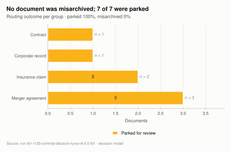
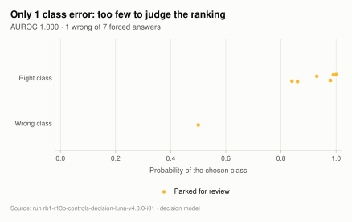
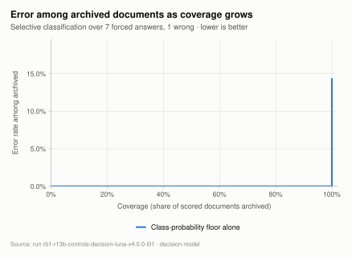
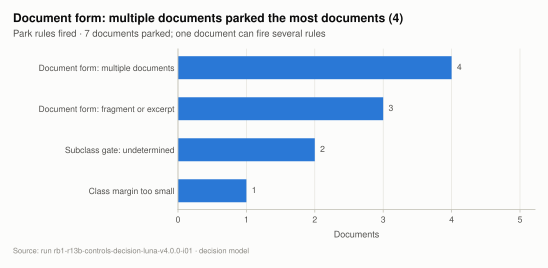
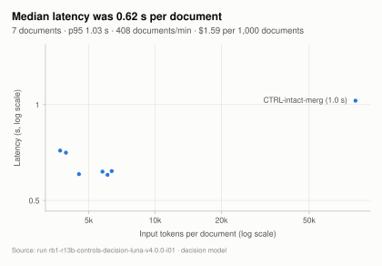

# Run report — `rb1-r13b-controls-decision-luna-v4.0.0-i01`

| | |
| --- | --- |
| campaign / experiment | `rb1` / `rb1-r13b` |
| run_id / iteration | `rb1-r13b-controls-decision-luna-v4.0.0` / `i01` |
| status | **done** |
| task / model | `sorter_reviewer` / `openai/gpt-6-luna-decisions` |
| spec_hash | `4cecaff35132c13b499f01c008567473e951dea900466b93b3de31fef926a3f6` |
| started → finished | 2026-11-19T11:09:34.932+00:00 → 2026-11-19T11:09:36.162+00:00 |
| documents ok / failed / total | 7 / 0 / 7 |
| dataset | `form-controls.jsonl` @ `bc9eab280044befb51e19dda3071d290a8677f42` (ground_truth/all) |
| source | [rb1-r13b-controls-decision-luna-v4.0.0-i01.report.json](rb1-r13b-controls-decision-luna-v4.0.0-i01.report.json) |

## Headline (run scorer, from the experiment log)

| metric | value |
| --- | --- |
| error_count | 0 |
| exact_match | 0.0000 |
| n | 7 |
| subclass_corrections_applied | 0 |
| subclass_match | 0.0000 |
| subclass_match_hub_truth | 0.0000 |
| subclass_scored | 7 |

## Subclass by truth class (SHF-013, reviewed corrections applied)

| class | n | correct | accuracy | Hub-truth accuracy |
| --- | --- | --- | --- | --- |
| contract | 1 | 0 | 0.0000 | 0.0000 |
| corporate_record | 1 | 0 | 0.0000 | 0.0000 |
| insurance_claim | 2 | 0 | 0.0000 | 0.0000 |
| merger_agreement | 3 | 0 | 0.0000 | 0.0000 |

## Figures

Each figure's data is in [`analysis/rb1-r13b-controls-decision-luna-v4.0.0-i01.figure-data.csv`](../analysis/rb1-r13b-controls-decision-luna-v4.0.0-i01.figure-data.csv)

## Cost and serving (serving renderer)

| metric | value |
| --- | --- |
| estimated_cost_usd | 0.011149 |
| cost_per_document | 0.001593 |
| cost_basis | token_price_estimate |
| wall_seconds | 260.065000 |
| prompt_tokens | 111486 |
| completion_tokens | — |

## Caveats

- Cost basis is `token_price_estimate` (from the serving renderer), not a provider invoice.
- docs/ config is the committed config today; the spec lock in logs/ is authoritative.
