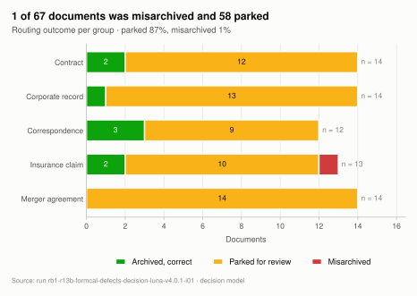
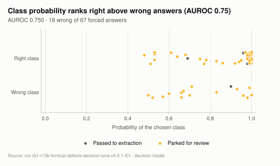
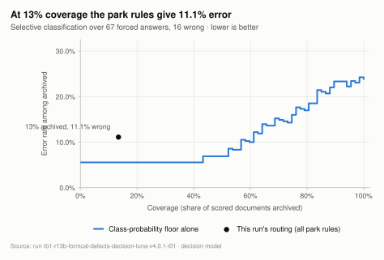
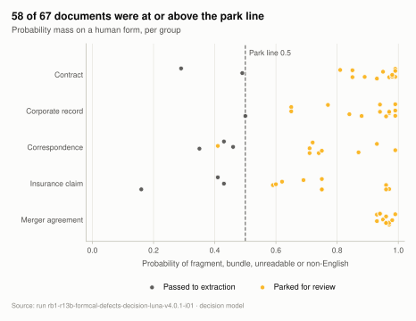
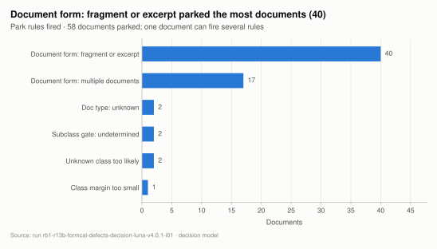
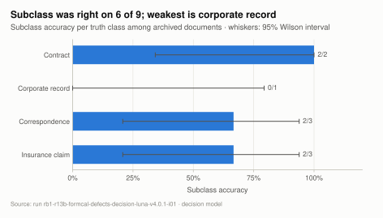
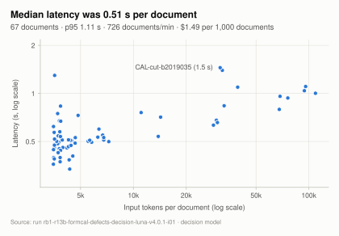

# Run report — `rb1-r13b-formcal-defects-decision-luna-v4.0.1-i01`

| | |
| --- | --- |
| campaign / experiment | `rb1` / `rb1-r13b` |
| run_id / iteration | `rb1-r13b-formcal-defects-decision-luna-v4.0.1` / `i01` |
| status | **done** |
| task / model | `sorter_reviewer` / `openai/gpt-6-luna-decisions` |
| spec_hash | `a2d2ff62d2f48c0748b7f6b3f665ebcebfcbcff8db20d640c6ee5c2275e1f6c2` |
| started → finished | 2026-11-19T15:57:24.697+00:00 → 2026-11-19T15:57:30.490+00:00 |
| documents ok / failed / total | 67 / 0 / 67 |
| dataset | `formcal-defects.jsonl` @ `bc9eab280044befb51e19dda3071d290a8677f42` (ground_truth/all) |
| source | [rb1-r13b-formcal-defects-decision-luna-v4.0.1-i01.report.json](rb1-r13b-formcal-defects-decision-luna-v4.0.1-i01.report.json) |

## Headline (run scorer, from the experiment log)

| metric | value |
| --- | --- |
| error_count | 0 |
| exact_match | 0.1194 |
| n | 67 |
| subclass_corrections_applied | 0 |
| subclass_match | 0.0896 |
| subclass_match_hub_truth | 0.0896 |
| subclass_scored | 67 |

## Subclass by truth class (SHF-013, reviewed corrections applied)

| class | n | correct | accuracy | Hub-truth accuracy |
| --- | --- | --- | --- | --- |
| contract | 14 | 2 | 0.1429 | 0.1429 |
| corporate_record | 14 | 0 | 0.0000 | 0.0000 |
| correspondence | 12 | 2 | 0.1667 | 0.1667 |
| insurance_claim | 13 | 2 | 0.1538 | 0.1538 |
| merger_agreement | 14 | 0 | 0.0000 | 0.0000 |

## Figures

Each figure's data is in [`analysis/rb1-r13b-formcal-defects-decision-luna-v4.0.1-i01.figure-data.csv`](../analysis/rb1-r13b-formcal-defects-decision-luna-v4.0.1-i01.figure-data.csv)

## Cost and serving (serving renderer)

| metric | value |
| --- | --- |
| estimated_cost_usd | 0.099568 |
| cost_per_document | 0.001486 |
| cost_basis | token_price_estimate |
| wall_seconds | 27.408000 |
| prompt_tokens | 995678 |
| completion_tokens | — |

## Caveats

- Cost basis is `token_price_estimate` (from the serving renderer), not a provider invoice.
- docs/ config is the committed config today; the spec lock in logs/ is authoritative.
