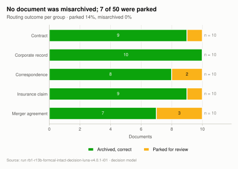
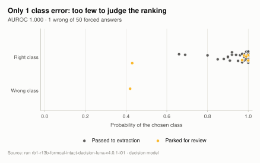
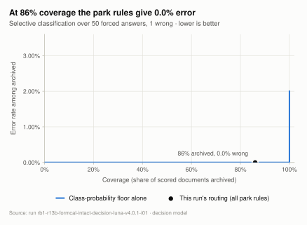
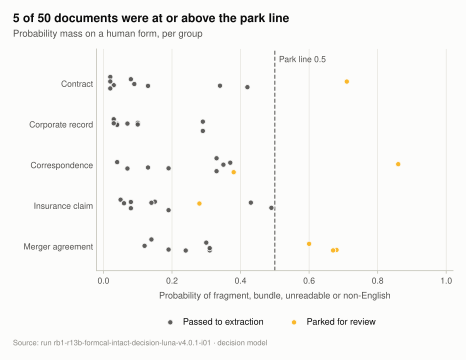
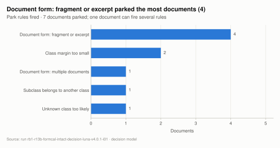
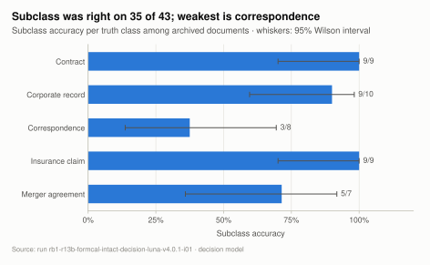
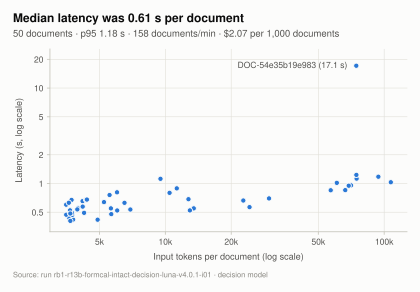

# Run report — `rb1-r13b-formcal-intact-decision-luna-v4.0.1-i01`

| | |
| --- | --- |
| campaign / experiment | `rb1` / `rb1-r13b` |
| run_id / iteration | `rb1-r13b-formcal-intact-decision-luna-v4.0.1` / `i01` |
| status | **done** |
| task / model | `sorter_reviewer` / `openai/gpt-6-luna-decisions` |
| spec_hash | `1b108907965aa4da2aedfb97a2eedad035e0ee40b4e20e9c9cdb8833416581f6` |
| started → finished | 2026-11-19T15:56:24.378+00:00 → 2026-11-19T15:56:43.669+00:00 |
| documents ok / failed / total | 50 / 0 / 50 |
| dataset | `Lucius-Morningstar/mailroom-dataset` @ `bc9eab280044befb51e19dda3071d290a8677f42` (ground_truth/all) |
| source | [rb1-r13b-formcal-intact-decision-luna-v4.0.1-i01.report.json](rb1-r13b-formcal-intact-decision-luna-v4.0.1-i01.report.json) |

## Headline (run scorer, from the experiment log)

| metric | value |
| --- | --- |
| error_count | 0 |
| exact_match | 0.8600 |
| n | 50 |
| subclass_corrections_applied | 0 |
| subclass_match | 0.7000 |
| subclass_match_hub_truth | 0.7000 |
| subclass_scored | 50 |

## Subclass by truth class (SHF-013, reviewed corrections applied)

| class | n | correct | accuracy | Hub-truth accuracy |
| --- | --- | --- | --- | --- |
| contract | 10 | 9 | 0.9000 | 0.9000 |
| corporate_record | 10 | 9 | 0.9000 | 0.9000 |
| correspondence | 10 | 3 | 0.3000 | 0.3000 |
| insurance_claim | 10 | 9 | 0.9000 | 0.9000 |
| merger_agreement | 10 | 5 | 0.5000 | 0.5000 |

## Figures

Each figure's data is in [`analysis/rb1-r13b-formcal-intact-decision-luna-v4.0.1-i01.figure-data.csv`](../analysis/rb1-r13b-formcal-intact-decision-luna-v4.0.1-i01.figure-data.csv)

## Cost and serving (serving renderer)

| metric | value |
| --- | --- |
| estimated_cost_usd | 0.103288 |
| cost_per_document | 0.002066 |
| cost_basis | token_price_estimate |
| wall_seconds | 50.991000 |
| prompt_tokens | 1032877 |
| completion_tokens | — |

## Caveats

- Cost basis is `token_price_estimate` (from the serving renderer), not a provider invoice.
- docs/ config is the committed config today; the spec lock in logs/ is authoritative.
