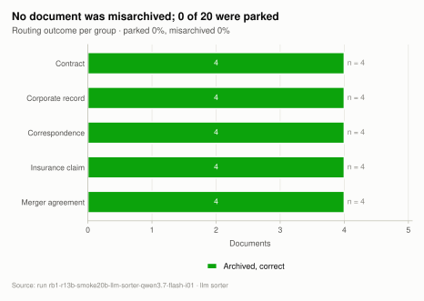
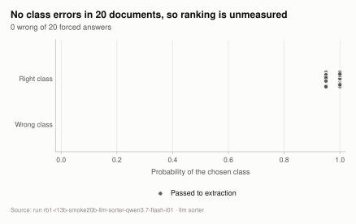
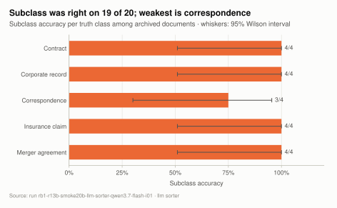
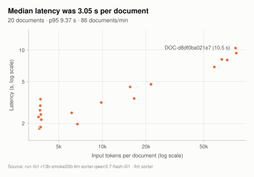

# Run report — `rb1-r13b-smoke20b-llm-sorter-qwen3.7-flash-i01`

| | |
| --- | --- |
| campaign / experiment | `rb1` / `rb1-r13b` |
| run_id / iteration | `rb1-r13b-smoke20b-llm-sorter-qwen3.7-flash` / `i01` |
| status | **done** |
| task / model | `isolated` / `qwen/qwen3.7-flash` |
| spec_hash | `460efe30a1f229ded04a2423eefd2c3e6250ade557238f62b3b897dbeaaa5c5d` |
| started → finished | 2026-11-19T11:10:42.411+00:00 → 2026-11-19T11:10:56.526+00:00 |
| documents ok / failed / total | 20 / 0 / 20 |
| dataset | `Lucius-Morningstar/mailroom-dataset` @ `bc9eab280044befb51e19dda3071d290a8677f42` (ground_truth/all) |
| source | [rb1-r13b-smoke20b-llm-sorter-qwen3.7-flash-i01.report.json](rb1-r13b-smoke20b-llm-sorter-qwen3.7-flash-i01.report.json) |

## Headline (run scorer, from the experiment log)

| metric | value |
| --- | --- |
| error_count | 0 |
| exact_match | 1.0000 |
| n | 20 |
| subclass_corrections_applied | 2 |
| subclass_match | 0.9500 |
| subclass_match_hub_truth | 0.8500 |
| subclass_scored | 20 |

## Subclass by truth class (SHF-013, reviewed corrections applied)

| class | n | correct | accuracy | Hub-truth accuracy |
| --- | --- | --- | --- | --- |
| contract | 4 | 4 | 1.0000 | 1.0000 |
| corporate_record | 4 | 4 | 1.0000 | 0.7500 |
| correspondence | 4 | 3 | 0.7500 | 0.7500 |
| insurance_claim | 4 | 4 | 1.0000 | 1.0000 |
| merger_agreement | 4 | 4 | 1.0000 | 0.7500 |

## Figures

Each figure's data is in [`analysis/rb1-r13b-smoke20b-llm-sorter-qwen3.7-flash-i01.figure-data.csv`](../analysis/rb1-r13b-smoke20b-llm-sorter-qwen3.7-flash-i01.figure-data.csv)

## Cost and serving (serving renderer)

| metric | value |
| --- | --- |
| estimated_cost_usd | 0.040206 |
| cost_per_document | 0.002010 |
| cost_basis | token_price_estimate |
| wall_seconds | 41.429000 |
| prompt_tokens | 474650 |
| completion_tokens | 2103 |

## Caveats

- Cost basis is `token_price_estimate` (from the serving renderer), not a provider invoice.
- docs/ config is the committed config today; the spec lock in logs/ is authoritative.
